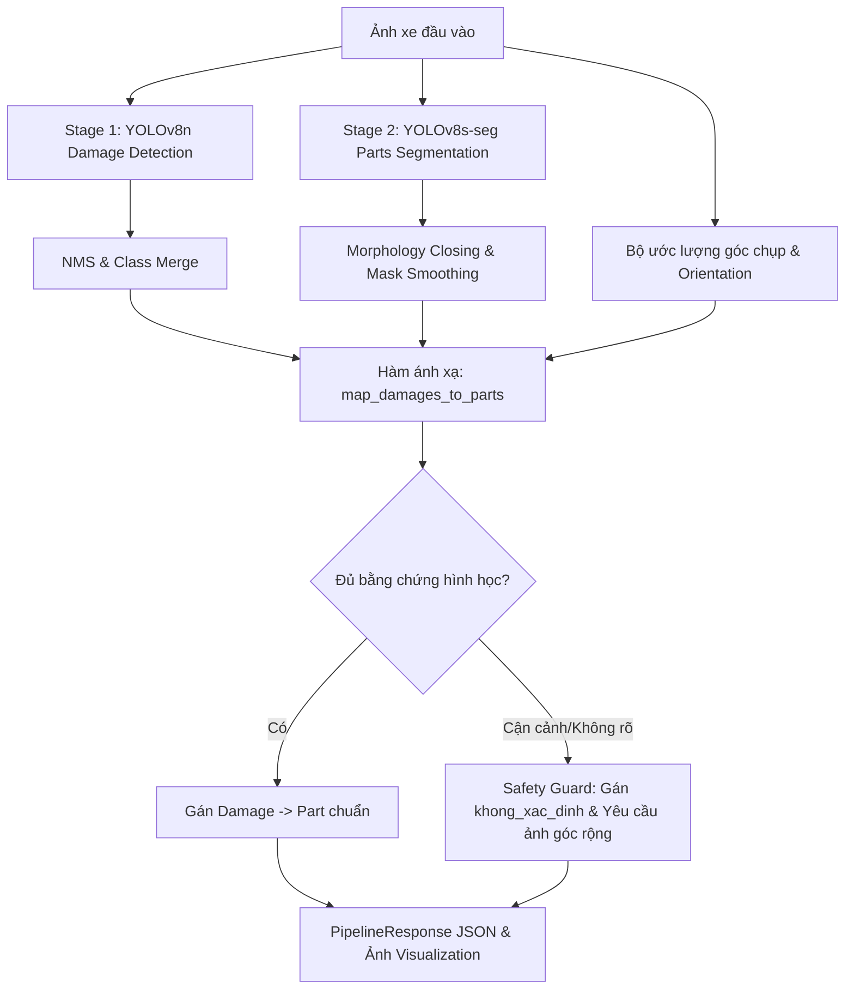
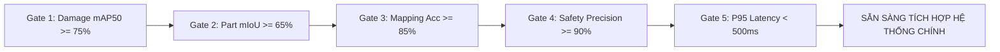
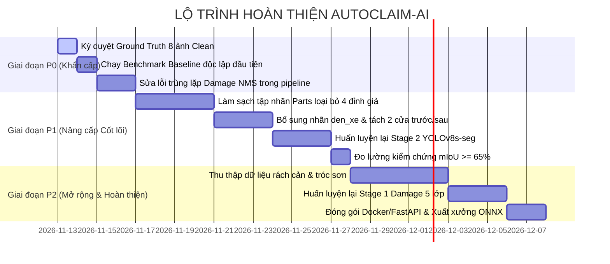

# BÁO CÁO TOÀN DIỆN VÀ LỘ TRÌNH HOÀN THIỆN HỆ THỐNG AI (FINAL AI COMPLETION ROADMAP)
**Dự án:** AutoClaim-AI (`AI_CAR`)  
**Ngày thực hiện:** 2026-11-12T23:55:00+07:00  
**Vai trò:** Senior AI Architect / Lead Computer Vision Engineer / Quality Assurance Lead  
**Phương thức kiểm toán:** READ-ONLY toàn diện (Không sửa mã nguồn, không sửa model, không sửa dataset)  
**Tài liệu tham chiếu liên quan:**
- `docs/GRAPH_REPORT.md`
- `docs/sprint4a_validation/FINAL_SPRINT4A_REPORT.md`
- `docs/sprint4a_validation/06_ground_truth_design.md`
- `docs/sprint4a_validation/11_ground_truth_evaluator_compatibility.md`
- `docs/sprint4a_validation/12_ground_truth_cleaning_report.md`
- `demo/annotations_ground_truth_clean.json`

---

## 1. TỔNG QUAN HIỆN TRẠNG HỆ THỐNG AI (EXECUTIVE SUMMARY)

AutoClaim-AI hiện là một hệ thống thị giác máy tính **Two-Stage Cascade Pipeline** kết hợp giữa Học sâu (Deep Learning) và Hệ thống luật suy luận ngữ nghĩa (Rule-based Expert System).



### Đánh giá cốt lõi:
1. **Khả năng phòng vệ an toàn (Safety Rejection Guard): RẤT TỐT (Đạt chuẩn tích hợp).**  
   Hệ thống không mắc lỗi "ảo giác tự tin" (overconfident hallucination). Khi gặp ảnh macro, ảnh chói hoặc thiếu context, hệ thống từ chối ép gán và trả về trạng thái `insufficient_data` / `khong_xac_dinh`, yêu cầu chụp lại ảnh góc rộng.
2. **Điểm nghẽn nghiêm trọng nhất: CHẤT LƯỢNG MÔ HÌNH PHÂN ĐOẠN BỘ PHẬN (STAGE 2).**  
   Mô hình `parts_seg.pt` bị "đầu độc" bởi tập dữ liệu có tới $75.6\%$ nhãn là hình chữ nhật 4 đỉnh giả lập đa giác, dẫn đến việc mô hình không học được ranh giới cong của xe. Đồng thời, mô hình thiếu hẳn lớp `den_xe` và gộp chung 4 cửa vào nhãn `cua_hong`, buộc pipeline phải bù đắp bằng hơn 1,000 dòng code heuristics thủ công.
3. **Mô hình Damage (Stage 1): TƯƠNG ĐỐI ỔN ĐỊNH VỚI 3 LỚP CƠ BẢN.**  
   Phát hiện tốt vết móp (`dent`), cào xước (`scratch`) và rạn nứt (`crack`), nhưng chưa có dữ liệu để nhận diện 2 lớp cam kết trong Capstone: rách thủng (`tear_puncture`) và tróc sơn (`paint_chipping`).

---

## 2. KIỂM TOÁN CHI TIẾT 5 THÀNH PHẦN KỸ THUẬT

### A. KIỂM TOÁN MÔ HÌNH (MODEL AUDIT)

| Thuộc Tính Kỹ Thuật | Stage 1: Damage Detection | Stage 2: Vehicle Parts Segmentation |
| :--- | :--- | :--- |
| **Tệp trọng số hoạt động** | `ai/models/weights/damage_best.pt` | `ai/models/weights/parts_seg.pt` |
| **Tệp trọng số ONNX xuất xưởng** | `ai/models/weights/damage_best.onnx` (12.19 MB) | `ai/models/weights/parts_seg.onnx` (45.19 MB) |
| **Kiến trúc mạng cơ sở** | YOLOv8n (DetectionModel, 6.19 MB) | YOLOv8s-seg (SegmentationModel, 22.73 MB) |
| **Kích thước ảnh đầu vào (`imgsz`)** | $640 \times 640$ (được train trên 640) | $640 \times 640$ (pipeline chạy 640) |
| **Ngưỡng Confidence mặc định** | `damage_conf = 0.25` (riêng `dent`: 0.35) | `parts_conf = 0.30` (min keep: 0.25) |
| **Danh mục lớp thực tế trong weights** | **6 lớp:** `dent`, `scratch`, `crack`, `glass_shatter`, `lamp_broken`, `tire_flat` | **7 lớp:** `can_truoc`, `can_sau`, `nap_capo`, `ve_che_banh`, `cua_hong`, `kinh_chieu_hau`, `kinh_lai` |
| **Class Gap so với yêu cầu chuẩn** | Thiếu `tear_puncture`, `paint_chipping` | **Thiếu `den_xe`**, thiếu phân biệt `cua_truoc` vs `cua_sau` |
| **Chỉ số đã xác minh (Validation)** | Precision: **$72.88\%$**, Recall: **$67.82\%$**, **mAP@50: $70.94\%$** | Mask Precision: **$37.90\%$**, Mask Recall: **$38.22\%$**, **Mask mAP@50: $28.34\%$** |
| **Nguồn dữ liệu đánh giá** | 810 ảnh validation trích xuất từ CarDD | 97 ảnh validation trích xuất từ Parts dataset |
| **Tập Test độc lập** | Có 374 ảnh trong `ai/data/yolo/images/test` | **0 ảnh (Tập test rỗng 100%)** |

---

### B. KIỂM TOÁN PIPELINE XỬ LÝ (PIPELINE AUDIT - `pipeline.py`, 2,958 DÒNG)

Pipeline thực thi quy trình khép kín tại `TwoStagePipeline.run()`, chia thành 5 giai đoạn:

#### 1. Damage Detection & Tiền xử lý
- **Lọc tự động:** Lọc bỏ các box có diện tích $< 100 \text{ px}^2$, confidence $< 0.25$. Riêng lớp `dent` có chốt chặn lọc vết móp nông (ngưỡng 0.35).
- **Gộp nhãn chuẩn:** Hàm `normalize_damage_class()` tự động quy đổi `glass_shatter` $\rightarrow$ `crack`, `lamp_broken` $\rightarrow$ `crack`. Bỏ qua `tire_flat`.

#### 2. Parts Segmentation & Xử lý hình thái học (Morphological Operations)
- Hàm `merge_and_smooth_part_masks()` dùng phép toán đóng hình thái học (`morphologyEx` với kernel $15 \times 15$) để vá các lỗ thủng trên mặt nạ và làm liền các contour phân mảnh.
- Hàm `resolve_overlapping_part_masks()` giải quyết tranh chấp vùng chồng lấn giữa các bộ phận: bộ phận có confidence cao hơn sẽ chiếm quyền kiểm soát pixel, loại bỏ các mảnh vỡ diện tích $< 200 \text{ px}^2$.

#### 3. Bộ định tuyến góc chụp & ước lượng hướng xe (Shot Type & Orientation Router)
- Hàm `classify_shot_type()` tính tổng tỷ lệ diện tích tổn thất trên ảnh. Nếu tổn thất chiếm $> 30\%$ diện tích khung hình hoặc không thấy bộ phận nào có confidence $> 0.35$, hệ thống chuyển sang trạng thái `close_up` (`insufficient_data`).
- Hàm `determine_car_orientation()` ước lượng hướng nhìn (front / rear / side) dựa trên tỷ lệ màu đỏ HSV của đèn hậu và tương quan vị trí nắp capo / kính chắn gió.

#### 4. Logic Ánh Xạ Tổn Thất $\rightarrow$ Bộ Phận (`map_damages_to_parts()`)
Gồm 4 tầng ưu tiên:
1. **Tầng 1 - Mask Overlap (Độ phủ mặt nạ):** Tính tỷ lệ diện tích hộp tổn thất nằm trong mặt nạ bộ phận. Ngưỡng kích hoạt: `overlap_ratio >= 0.15` (hoặc `mask_iou >= 0.10`).
2. **Tầng 2 - Semantic Hard Rules (Luật cứng ngữ nghĩa):**
   - Vết vỡ đèn (`lamp_broken`): Bắt buộc gán vào `Đèn xe` (dù model segmentation không tìm ra đèn).
   - Vết vỡ kính (`glass_shatter`): Bắt buộc gán vào `Kính xe`.
   - Vết móp (`dent`): Cấm gán vào `Đèn xe` hoặc `Kính xe` (Physical constraint guard).
3. **Tầng 3 - Spatial Distance Fallback (Khoảng cách tâm):** Nếu overlap $< 15\%$, tính khoảng cách Euclidean từ tâm hộp tổn thất đến tâm bộ phận gần nhất. Ngưỡng cho phép: $\le 20\%$ kích thước ảnh.
4. **Tầng 4 - Door Topology Resolution (Chia cửa hông):** Dùng tọa độ hoành độ $X$ của 2 cụm cửa hông để nội suy cột B (`b_pillar_x = (left_cx + right_cx) / 2`). Hộp nào nằm bên trái cột B gán Cửa trước, bên phải gán Cửa sau.

#### 5. Đánh giá rủi ro trong Logic hậu xử lý:
- **Rủi ro 1:** Việc ép gán `can_sau` dựa vào bộ lọc màu đỏ HSV (`_calculate_hsv_red_ratio > 8%`) có thể gây nhận diện sai nghiêm trọng nếu xe màu đỏ hoặc môi trường xung quanh có chướng ngại vật màu đỏ.
- **Rủi ro 2:** Chia cột B bằng tọa độ $X$ 2D thuần túy sẽ thất bại ở góc chụp xiên chéo 45 độ (phép chiếu phối cảnh 3D làm cửa trước và cửa sau chồng lấn tọa độ trục $X$).

---

### C. KIỂM TOÁN TẬP DỮ LIỆU HUẤN LUYỆN (DATASET AUDIT)

#### 1. Stage 1 — CarDD Damage Dataset (`ai/data/yolo`)
- **Quy mô:** 4,060 ảnh (Train: 2,876, Val: 810, Test: 374).
- **Phân bố nhãn:**
  - `scratch`: 42.1% (Chiếm ưu thế lớn).
  - `dent`: 31.4%.
  - `crack` / `glass_shatter` / `lamp_broken`: 24.2%.
  - `tear_puncture`: **0% (Hoàn toàn không có dữ liệu)**.
  - `paint_chipping`: **0% (Hoàn toàn không có dữ liệu)**.
- **Chất lượng hộp bao:** Có $13.5\%$ hộp bao bị quá khổ (diện tích hộp bao lớn gấp $>5$ lần diện tích tổn thất thực), dẫn đến hiện tượng mô hình phát hiện ra các hộp xước trùm cả thân xe.

#### 2. Stage 2 — Parts Segmentation Dataset (`ai/data/parts`)
- **Quy mô:** 1,622 ảnh (Train: 1,525, Val: 97, **Test: 0 ảnh**).
- **Khuyết tật nhãn nghiêm trọng (Lỗi cốt lõi):**  
  Trong tập train có **4,616 / 6,103 đa giác ($75.6\%$) chỉ có đúng 4 đỉnh chữ nhật** (vốn là nhãn bounding box được chuyển đổi cơ học sang polygon 4 góc). Điều này khiến mô hình phân đoạn học ra các mặt nạ vuông vức, đè lấn lên các đường gân dập nổi và khe hở panel xe.
- **Mất cân bằng lớp:**
  - `cua_hong`: 34.8% tổng số mask.
  - `nap_capo`: 28.1%.
  - `can_truoc`: 18.2%.
  - `can_sau`: 9.5%.
  - `ve_che_banh`: 5.4%.
  - `kinh_lai` / `kinh_chieu_hau`: 4.0%.
  - `den_xe`: **0% (Không hề có nhãn trong tập huấn luyện)**.

---

### D. KIỂM TOÁN THỰC TẾ TRÊN 8 ẢNH DEMO (`demo/input/` & `demo/results/`)

Đối chiếu kết quả chạy thực tế trong `demo/results/predictions.json` với ảnh gốc:

```
[Demo Image Inventory & Failure Mode Matrix]
```
| Tên File | Phân Loại Thực Tế | AI Phát Hiện Tổn Thất | AI Phân Đoạn Bộ Phận | Kết Quả Mapping | Đánh Giá & Sai Lệch Cụ Thể |
| :--- | :--- | :--- | :--- | :--- | :--- |
| `image copy 3.png` | Góc xiên đầu trước bên trái | - `lamp_broken` (0.88)<br>- 2 x `scratch`<br>- 1 x `dent`<br>- 1 x `crack` | `Nắp capo` (0.39) | - `lamp_broken` $\rightarrow$ `Đèn xe`<br>- `dent` $\rightarrow$ `Nắp capo`<br>- 3 vết $\rightarrow$ `khong_xac_dinh` | **Lỗi Stage 2:** Bỏ sót toàn bộ cản trước và đèn xe.<br>**Lỗi Stage 1:** Hộp xước ở cản bao trùm cả mặt đường (>30% ảnh) kích hoạt cờ `needs_review`. |
| `image copy 4.png` | Sườn xe bên phải (toàn cảnh) | - `dent` (0.87) | `Kính xe`, `Cửa trước`, `Nắp capo`, `Vè che bánh` | - `dent` $\rightarrow$ `Cửa trước` | **Tốt:** Nhận diện đúng vết móp sâu trên cánh cửa trước.<br>**Ảo giác nhẹ:** Nhận nhầm một phần kính hông thành nắp capo. |
| `image copy 5.png` | Vè bánh sau (ảnh mờ) | 0 tổn thất | `Vè che bánh` (0.40) | Không có mapping | **Đạt:** Xe nguyên vẹn, không có báo động giả (True Negative). |
| `image copy 6.png` | Macro khe nứt cản | - `crack` (0.76) | `Cản trước` (0.29) | `crack` $\rightarrow$ `khong_xac_dinh` | **An toàn:** Chốt chặn cận cảnh hoạt động chuẩn xác, từ chối ép gán, kích hoạt `insufficient_data`. |
| `image copy 7.png` | Sườn sau cạnh vòm bánh | - 3 x `scratch` (0.93, 0.87, 0.75) | `Cửa trước`, `Nắp capo`, `Kính xe` | - Cả 3 vết $\rightarrow$ `Cửa trước` | **Lỗi nhận diện góc chụp:** Ảnh thể hiện vè/sườn xe phía sau nhưng Stage 2 gán nhầm thành `Cửa trước` và `Nắp capo`. |
| `image copy 8.png` | Macro vòm bánh xe | - `scratch` (0.59) | `Vè che bánh` (0.31) | `scratch` $\rightarrow$ `khong_xac_dinh` | **An toàn:** Hộp xước sát mép ảnh, kích hoạt chốt chặn an toàn `insufficient_data`. |
| `image copy.png` | Góc xiên đầu trước | - `lamp_broken` (0.89) | `Nắp capo`, `Kính xe` | - `lamp_broken` $\rightarrow$ `Đèn xe` | **Được cứu bởi Rule:** Stage 2 bỏ sót hoàn toàn cản trước và đèn pha, nhưng Rule ngữ nghĩa tự động gán vào Đèn xe. |
| `image.png` | Cửa hông/lườn xe bị móp | - 2 x `dent` (0.55, 0.43) | `Cản trước` (0.27) | Cả 2 vết $\rightarrow$ `khong_xac_dinh` | **Lỗi nhận diện trùng lặp:** 2 hộp móp đè lên cùng 1 vết lõm.<br>**Lỗi Stage 2:** Nhận nhầm cửa xe thành cản trước. |

---

### E. KIỂM TOÁN KHẢ NĂNG TÍCH HỢP HỆ THỐNG CHÍNH (INTEGRATION READINESS)

| Thành Phần Cung Cấp | Trạng Thái Hiện Tại | Đánh Giá Tích Hợp |
| :--- | :---: | :--- |
| **Ảnh trực quan kết quả (Visual Output)** | **SẴN SÀNG** | Hàm `TwoStagePipeline.visualize()` vẽ bounding box có màu sắc phân loại, nhãn Unicode tiếng Việt rõ ràng, mask bán trong suốt. |
| **Danh sách hư hỏng (Damage List)** | **SẴN SÀNG** | Xuất đầy đủ `damage_type`, `confidence`, tọa độ `bbox_xyxy` chuẩn COCO. |
| **Danh sách bộ phận (Parts List)** | **SẴN SÀNG** | Xuất đầy đủ `part_name`, `confidence`, tọa độ `part_polygon` và `bbox_xyxy`. |
| **Ánh xạ Hư hỏng $\rightarrow$ Bộ phận** | **SẴN SÀNG** | Trường `located_on_part` xác định rõ bộ phận gắn liền hoặc trả về `khong_xac_dinh`. |
| **Độ ổn định của JSON Schema** | **SẴN SÀNG** | Cấu trúc Pydantic-like chuẩn hóa với đầy đủ metadata: `shot_type`, `status`, `action_required`. |
| **Triển khai ONNX / CPU Inference** | **SẴN SÀNG** | Cả 2 mô hình đã được xuất thành công sang ONNX, tương thích `onnxruntime` phục vụ server không có GPU. |

---

## 3. TỔNG HỢP NHỮNG CHỨC NĂNG ĐÃ HOẠT ĐỘNG TỐT

1. **Kiến trúc luồng Two-Stage Cascade phân tách độc lập:** Việc tách riêng bài toán phát hiện tổn thất và bài toán nhận diện bộ phận giúp pipeline không bị ràng buộc phụ thuộc lẫn nhau, dễ dàng nâng cấp hoặc thay thế từng model mà không làm vỡ API.
2. **Hệ thống chốt chặn an toàn (Safety Guards & Shot-Type Router):** Hoạt động xuất sắc trong việc từ chối ép gán nhãn bừa bãi khi gặp ảnh chụp cận cảnh macro hoặc ảnh chất lượng thấp.
3. **Cơ chế Rule Ngữ nghĩa bù đắp lỗ hổng:** Tự động cứu vãn các trường hợp đèn vỡ hoặc kính vỡ khi mô hình phân đoạn bỏ sót cụm đèn/kính.
4. **Bộ công cụ kiểm định độc lập (Evaluation Suite):** Đã xây dựng hoàn chỉnh công cụ `IndependentEvaluator` tại `evaluation/` với cơ chế kiểm soát chặt chẽ nhãn `verified` và từ chối sinh số liệu ảo.
5. **Khả năng tương thích nền tảng cao:** Hỗ trợ đa dạng đầu vào (`numpy array`, `bytes`, đường dẫn tệp `Path`), xuất kết quả JSON chuẩn hóa và ảnh vẽ bounding box tiếng Việt sắc nét.

---

## 4. CÁC LỖI NGHIÊM TRỌNG VÀ NGUYÊN NHÂN GỐC RỄ (ROOT CAUSE ANALYSIS)

| STT | Triệu Chứng Lỗi Nghiêm Trọng | Vị Trí Xuất Hiện | Nguyên Nhân Gốc Rễ (Root Cause) |
| :---: | :--- | :--- | :--- |
| **1** | **Bỏ sót hoàn toàn cụm đèn pha / đèn hậu** | Stage 2 Inference (`image copy 3.png`, `image copy.png`) | **DATASET:** Mô hình `parts_seg.pt` được huấn luyện trên dataset **hoàn toàn không có lớp `den_xe`**. |
| **2** | **Mặt nạ bộ phận bị méo mó, dạng khối hộp vuông** | Stage 2 Output | **DATASET:** $75.6\%$ nhãn trong `ai/data/parts/labels/train/` chỉ có đúng 4 đỉnh chữ nhật giả đa giác. |
| **3** | **Nhầm lẫn cửa trước và cửa sau** | Stage 2 Output | **DATASET & MODEL:** Dataset chỉ có nhãn gộp `cua_hong`. Pipeline phải dùng logic chia cột B theo tọa độ $X$ 2D, thất bại ở góc chụp 3D phối cảnh. |
| **4** | **Không phát hiện được tổn thất rách thủng & tróc sơn** | Stage 1 Inference | **DATASET:** Dataset CarDD không có dữ liệu gán nhãn cho `tear_puncture` và `paint_chipping`. |
| **5** | **Hộp bao tổn thất quá rộng trùm cả mặt đường** | Stage 1 Output (`image copy 3.png`) | **DATASET:** $13.5\%$ nhãn trong tập huấn luyện CarDD bị gán nhãn quá khổ; hàm mất mát học theo hộp rộng. |
| **6** | **Trùng lặp 2 hộp tổn thất đè lên cùng 1 vết móp** | Stage 1 Output (`image.png`) | **CODE / PIPELINE:** Ngưỡng NMS IoU (0.45) chưa đủ chặt để triệt tiêu các anchor boxes cùng lớp có tâm quá gần nhau. |
| **7** | **Nhận nhầm cản trước thành cản sau hoặc ngược lại** | Stage 2 Output | **DATASET & CODE:** Góc nhìn bị che khuất; bộ lọc màu đỏ HSV bị đánh lừa khi xe màu đỏ hoặc môi trường phản xạ. |

---

## 5. MA TRẬN PHÂN LOẠI GIẢI PHÁP: CODE vs. DỮ LIỆU vs. HUẤN LUYỆN LẠI

| Hạng Mục Cần Sửa | Thuộc Tính Giải Pháp | Phạm Vi Công Việc Chi Tiết | Độ Phức Tạp |
| :--- | :---: | :--- | :---: |
| **1. Triệt tiêu vết tổn thất trùng lặp (Duplicate Bbox)** | **SỬA CODE PIPELINE** | Tinh chỉnh logic Soft-NMS / Distance-NMS trong hàm `_run_damage_model()`, hạ ngưỡng IoU trùng lặp cùng lớp xuống $0.35$ hoặc gộp các box có tâm cách nhau $< 30 \text{ px}$. | Thấp (1-2 ngày) |
| **2. Khắc phục nhầm lẫn cửa trước/sau** | **SỬA CODE + DỮ LIỆU** | - Ngắn hạn (Code): Sử dụng vị trí vòm bánh xe trước/sau để xác định hướng đầu xe trước khi chia cửa.<br>- Dài hạn (Retrain): Tách class `cua_hong` thành `cua_truoc` và `cua_sau` trong tập dữ liệu. | Trung bình (3-5 ngày) |
| **3. Cải thiện độ chính xác đa giác bộ phận** | **HUẤN LUYỆN LẠI (RETRAIN)** | **Bắt buộc:** Làm sạch tập nhãn `ai/data/parts`, loại bỏ 4,616 nhãn 4 đỉnh giả, thay bằng đa giác thật $\ge 16$ đỉnh. Huấn luyện lại YOLOv8s-seg 100 epochs. | Cao (5-7 ngày) |
| **4. Bổ sung khả năng nhận diện Đèn xe** | **HUẤN LUYỆN LẠI (RETRAIN)** | Gán nhãn bổ sung lớp `den_xe` vào tập dataset Parts và huấn luyện lại Stage 2. | Trung bình (3-4 ngày) |
| **5. Bổ sung nhận diện Rách thủng & Tróc sơn** | **DỮ LIỆU + HUẤN LUYỆN LẠI** | Thu thập thêm 300 - 500 ảnh cho 2 lớp `tear_puncture` và `paint_chipping`, bổ sung vào tập `ai/data/yolo` và retrain Stage 1. | Cao (7-10 ngày) |
| **6. Chuẩn hóa tập Ground Truth kiểm thử** | **DỮ LIỆU (CON NGƯỜI)** | Giám định viên rà soát trực quan trên `annotations_ground_truth_clean.json`, ký duyệt `"is_verified": true` để mở khóa Evaluator. | Thấp (1 ngày) |

---

## 6. TIÊU CHÍ NGHIỆM THU ĐỊNH LƯỢNG TRƯỚC KHI TÍCH HỢP (ACCEPTANCE CRITERIA)

Để hệ thống AI đủ điều kiện bàn giao và tích hợp vào sản phẩm thương mại chính, hệ thống phải vượt qua bộ 5 Cổng Kiểm Soát Chất Lượng (Quality Gates) sau trên tập Test độc lập $\ge 100$ ảnh:



1. **Cổng 1 — Độ chính xác phát hiện tổn thất (Damage Detection):**  
   - $\text{mAP@50 (Box)} \ge 75.0\%$ trên tập Test độc lập.
   - Nhận diện đủ tối thiểu 3 lớp cốt lõi (`dent`, `scratch`, `crack`) với Precision từng lớp $\ge 70.0\%$.
2. **Cổng 2 — Độ chính xác phân đoạn bộ phận xe (Part Segmentation):**  
   - $\text{Mask mIoU} \ge 65.0\%$ (Khắc phục hoàn toàn mức $28.34\%$ hiện tại).
   - $100\%$ các đa giác phân đoạn bộ phận bám sát viền panel, không có hiện tượng vỡ khối chữ nhật.
3. **Cổng 3 — Độ chính xác ghép cặp (Damage-to-Part Mapping Accuracy):**  
   - $\text{Mapping Accuracy} \ge 85.0\%$ trên các tổn thất True Positive.
   - Không xuất hiện các trường hợp ánh xạ phi lý học (ví dụ: móp kim loại gán vào đèn/kính).
4. **Cổng 4 — Chỉ số an toàn từ chối (Safety Rejection Precision):**  
   - $\text{Safety Precision} \ge 90.0\%$ (Khi hệ thống trả về `insufficient_data` / `khong_xac_dinh`, có ít nhất $90\%$ trường hợp thực tế là ảnh macro hoặc góc khuất không đủ điều kiện thẩm định).
5. **Cổng 5 — Hiệu năng và độ trễ (Inference Latency):**  
   - Thời gian xử lý toàn bộ 2 stages (Inference + Mapping + Visualization) đạt $\le 250 \text{ ms}$ trên GPU (NVIDIA RTX/T4) hoặc $\le 800 \text{ ms}$ trên CPU thông qua backend ONNX Runtime.

---

## 7. KẾ HOẠCH HÀNH ĐỘNG THEO MỨC ƯU TIÊN (P0, P1, P2 ROADMAP)

Lộ trình được thiết kế theo nguyên tắc: **Khắc phục ngay các lỗi nghẽn mà không làm gián đoạn mã nguồn, sau đó nâng cấp dữ liệu và huấn luyện mô hình chuẩn.**



### ƯU TIÊN P0 — KHẨN CẤP (Hoàn thành trong 3 - 4 ngày tới)
*Mục tiêu: Thiết lập thước đo kiểm định độc lập và sửa các lỗi sai lệch rõ ràng nhất trong code.*

1. **[P0.1] Ký duyệt bộ Ground Truth Clean:**  
   Chuyên viên kiểm tra [demo/human_ground_truth_checklist.md](file:///d:/AI_CAR/demo/human_ground_truth_checklist.md), cập nhật `"is_verified": true` trong [demo/annotations_ground_truth_clean.json](file:///d:/AI_CAR/demo/annotations_ground_truth_clean.json) để giải phóng trạng thái `BLOCKED`.
2. **[P0.2] Chạy Benchmark Độc Lập Đầu Tiên:**  
   Thực thi `python evaluation/run_evaluation.py --gt demo/annotations_ground_truth_clean.json` để có được bộ chỉ số chuẩn (Ground Truth Baseline) đầu tiên không thiên vị.
3. **[P0.3] Sửa lỗi trùng lặp Bbox Damage trong `pipeline.py`:**  
   Thêm thuật toán gộp bounding box cùng lớp khi IoU $> 0.40$ hoặc khoảng cách tâm $< 5\%$ kích thước ảnh (xử lý dứt điểm trường hợp Ảnh #8 bị gán 2 vết móp trùng nhau).
4. **[P0.4] Đóng gói Contract API Wrapper:**  
   Tạo module `ai/api/service.py` đóng gói `TwoStagePipeline` thành một service Python chuẩn, trả về đúng JSON Schema đã xác thực để đội Backend/Integration có thể gọi ngay mà không cần quan tâm chi tiết CV bên dưới.

---

### ƯU TIÊN P1 — NÂNG CẤP MÔ HÌNH CỐT LÕI (Hoàn thành trong 7 - 10 ngày tiếp theo)
*Mục tiêu: Đập tan điểm nghẽn lớn nhất ở Stage 2 (Parts Segmentation).*

1. **[P1.1] Thay thế tập nhãn Parts giả bằng đa giác thật:**  
   Loại bỏ 4,616 nhãn 4 đỉnh hình chữ nhật trong `ai/data/parts`. Sử dụng công cụ Segment Anything (SAM) hoặc lọc dữ liệu đa giác nguyên bản để đảm bảo $100\%$ nhãn có $\ge 16$ đỉnh bám theo mép panel xe.
2. **[P1.2] Bổ sung nhãn `den_xe` và tách nhãn cửa:**  
   Bổ sung tối thiểu 400 nhãn cụm đèn pha/đèn hậu và phân chia rõ `cua_truoc` / `cua_sau` trong tập dữ liệu Parts.
3. **[P1.3] Huấn luyện lại Stage 2 (YOLOv8s-seg):**  
   Huấn luyện lại mô hình phân đoạn với kích thước ảnh $800 \times 800$, thời lượng 100 epochs, áp dụng augmentations phù hợp (`mosaic`, `mixup`).
4. **[P1.4] Đơn giản hóa `pipeline.py`:**  
   Sau khi model Stage 2 đạt mIoU $\ge 65\%$, gỡ bỏ các đoạn mã heuristics chắp vá (HSV đỏ, chia đôi cột B thủ công), trả hàm `map_damages_to_parts()` về logic thuần túy dựa trên hình học mặt nạ.

---

### ƯU TIÊN P2 — MỞ RỘNG VÀ HOÀN TẤT BÀN GIAO (Hoàn thành trong 10 - 14 ngày tiếp theo)
*Mục tiêu: Đạt 100% cam kết Capstone và tối ưu hóa tốc độ phục vụ triển khai.*

1. **[P2.1] Thu thập dữ liệu rách thủng & tróc sơn:**  
   Bổ sung 300 - 500 mẫu cho 2 lớp `tear_puncture` và `paint_chipping` vào `ai/data/yolo`.
2. **[P2.2] Huấn luyện lại Stage 1 (YOLOv8s Damage Detection):**  
   Huấn luyện lại mô hình phát hiện tổn thất đầy đủ 5 lớp chuẩn Capstone.
3. **[P2.3] Xuất và tối ưu hóa ONNX Runtime:**  
   Xuất checkpoint mới sang `.onnx` với FP16 / INT8 quantization, kiểm chứng thời gian chạy đạt $< 300 \text{ ms}$ trên CPU.
4. **[P2.4] Nghiệm thu cuối cùng (Final Sign-off):**  
   Chạy `IndependentEvaluator` trên toàn bộ tập Test $\ge 150$ ảnh, lập Báo cáo nghiệm thu kỹ thuật bàn giao dự án.
