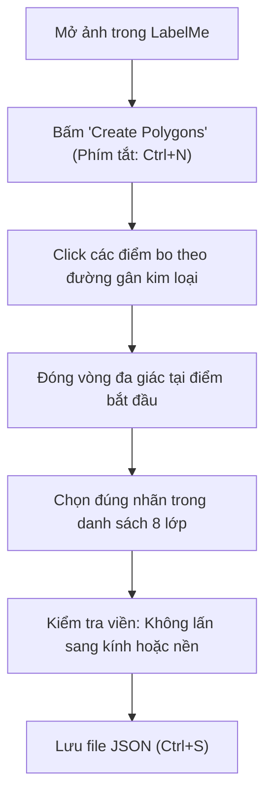

# CẨM NANG HƯỚNG DẪN GÁN NHÃN BỘ PHẬN NGOẠI THẤT XE Ô TÔ
## (HUMAN ANNOTATION GUIDE — STAGE 2 PILOT)

**Dự án:** AutoClaim-AI — Hệ thống giám định tổn thất xe cơ giới  
**Phạm vi áp dụng:** Bộ dữ liệu thử nghiệm Pilot 80 ảnh (`ai/data/parts_pilot/`)  
**Đối tượng:** Chuyên gia thẩm định, Kỹ sư AI, Chuyên viên gán nhãn dữ liệu (Data Annotator)  

---

## 1. MỤC TIÊU VÀ TẦM QUAN TRỌNG CỦA CHẤT LƯỢNG GÁN NHÃN

Trong thị giác máy tính phục vụ giám định xe cơ giới, mô hình phân đoạn (Segmentation) chỉ có thể học đúng đường biên vật lý nếu dữ liệu huấn luyện phản ánh chính xác ranh giới của từng tấm kim loại và kính. 

Trước đây, 75.63% nhãn cũ là các hình chữ nhật 4 đỉnh sinh tự động từ bounding box, khiến AI dự đoán cản xe và kính lái thành các khối vuông vức che lấp nhau. Giai đoạn **Pilot Stage 2** xây dựng Ground Truth chuẩn mực đầu tiên cho **8 bộ phận ngoại thất xe**, đòi hỏi đa giác vẽ tay phải ôm sát đường mép dập nổi cơ khí thực tế.

---

## 2. DANH MỤC 8 LỚP NGOẠI THẤT CHUẨN HÓA

| Class ID | Mã lớp (Label ID) | Tên bộ phận tiếng Việt | Phạm vi ranh giới nhận diện |
| :---: | :--- | :--- | :--- |
| **0** | `can_truoc` | Cản trước (Front Bumper) | Toàn bộ ốp cản nhựa/kim loại phía trước, từ mép dưới lưới tản nhiệt/đèn pha xuống gầm xe và ôm sang hai bên mép vè bánh trước. |
| **1** | `can_sau` | Cản sau (Rear Bumper) | Toàn bộ ốp cản sau xe, từ mép cốp/đèn hậu xuống mép ống xả/gầm sau và ôm sang hai mép vè bánh sau. |
| **2** | `nap_capo` | Nắp capo (Hood) | Nắp đậy khoang động cơ, giới hạn bởi khe rãnh tiếp giáp hai tai vè trước, mép trên lưới tản nhiệt và mép chân kính lái. |
| **3** | `ve_che_banh` | Vè che bánh (Fender) | Tấm kim loại vòm vè che bánh xe: vè trước (nằm giữa cản trước, nắp capo và cửa trước) và vè hông sau (Quarter Panel, từ cửa sau đến cản sau). |
| **4** | `cua_truoc` | Cửa trước (Front Door) | Cánh cửa trước (bên lái hoặc bên phụ), giới hạn bởi khe hở tiếp giáp vè trước, mép dưới kính cửa, khe hở với cửa sau và bệ bước chân. *(Không bao gồm kính cửa sổ).* |
| **5** | `cua_sau` | Cửa sau (Rear Door) | Cánh cửa sau, giới hạn bởi khe hở tiếp giáp cửa trước, mép dưới kính cửa sổ sau, mép vè sau và bệ bước chân. *(Không bao gồm kính cửa sổ).* |
| **6** | `kinh_xe` | Kính xe (Vehicle Glass) | Toàn bộ các bề mặt kính trong suốt: Kính chắn gió trước (kính lái), kính sau (kính hậu) và các ô kính cửa sổ hông. Viền đa giác bám sát gioăng cao su viền kính. |
| **7** | `den_xe` | Đèn xe (Vehicle Lights) | Cụm đèn pha trước, đèn sương mù gầm cản và cụm đèn hậu phía sau. Vẽ ôm sát viền vỏ nhựa/thủy tinh của cụm đèn. |

---

## 3. CÀI ĐẶT VÀ KHỞI CHẠY CÔNG CỤ GÁN NHÃN

### 3.1. Cài đặt công cụ LabelMe
LabelMe là công cụ mã nguồn mở vẽ đa giác chuẩn hóa, xuất dữ liệu định dạng JSON độc lập cho từng ảnh.

- **Cách 1: Cài đặt qua Python pip (Khuyến nghị):**
  ```powershell
  pip install pyqt6 labelme
  ```
- **Cách 2: Sử dụng bản Portable (.exe không cần cài đặt):**
  Tải tệp `Labelme.exe` từ trang chính thức:
  `https://github.com/labelmeai/labelme/releases`

### 3.2. Khởi chạy công cụ với cấu hình AutoClaim-AI
Chạy script tự động đã được cấu hình sẵn đường dẫn ảnh Pilot và danh mục 8 lớp:
```powershell
python ai/scripts/launch_annotation_tool.py
```

*Hoặc nếu sử dụng dòng lệnh trực tiếp:*
```powershell
labelme ai/data/parts_pilot/images --labels ai/data/parts_pilot/annotation_config/labels.txt --output ai/data/parts_pilot/annotations_raw --nodata
```
> [!IMPORTANT]
> **Cờ `--nodata`:** Tuyệt đối giữ cờ này để LabelMe không nhúng chuỗi base64 khổng lồ của bức ảnh vào file JSON, giúp dung lượng file JSON chỉ từ 5KB đến 15KB, đọc/ghi tức thì.

---

## 4. QUY TẮC KỸ THUẬT VẼ ĐA GIÁC (POLYGON RULES)



### Các nguyên tắc bắt buộc:
1. **Phân tách rạch ròi Cửa trước (`cua_truoc`) và Cửa sau (`cua_sau`):**
   - Click các điểm dọc theo khe rãnh cơ học hở giữa hai cánh cửa xe. Tuyệt đối không vẽ một khối bao trùm cả hai cửa như mô hình cũ.
2. **Tách biệt Đèn xe (`den_xe`) khỏi Cản và Vè:**
   - Cụm đèn pha hoặc đèn hậu thường nằm giáp mí cản trước/sau và vè bánh. Cần vẽ đa giác riêng cho đèn xe, đa giác cản xe sẽ bao quanh viền đèn chứ không chồng lấn lên đèn.
3. **Phân biệt Kính xe (`kinh_xe`) và Thân vỏ kim loại:**
   - Đa giác kính xe bám theo gioăng viền kính cao su. Không bao trùm các cột kim loại (trụ A, B, C) hoặc viền mạ crom.
4. **Không suy diễn bộ phận bị che khuất:**
   - Chỉ vẽ những bề mặt nhìn thấy rõ trong góc chụp. Nếu cản sau bị đuôi xe hoặc tường che mất một nửa, chỉ vẽ phần nhìn thấy.
5. **Mật độ điểm polygon:**
   - Các cạnh thẳng (như khe cửa, mép capo): Cần 3 - 5 điểm.
   - Các cung cong (như vòm vè che bánh, cụm đèn vuốt nhọn): Cần 10 - 20 điểm để đa giác mượt mà, ôm sát đường cong vật lý.

---

## 5. QUY TRÌNH THẨM ĐỊNH VÀ QUẢN LÝ TIẾN ĐỘ

Toàn bộ 80 ảnh được quản lý vòng đời chặt chẽ qua file [`ai/data/parts_pilot/annotation_tracking.csv`](file:///d:/AI_CAR/ai/data/parts_pilot/annotation_tracking.csv).

```text
[NOT_STARTED] ──> [IN_PROGRESS] ──> [ANNOTATED] ──> [REVIEW_REQUIRED] ──> [APPROVED]
                                                             │
                                                             └──> [REJECTED] (Vẽ lại)
```

### Các lệnh quản lý tiến độ:
- **Xem tổng quan tiến độ:**
  ```powershell
  python ai/scripts/manage_annotation_tracking.py --summary
  ```
- **Đồng bộ tự động số lượng polygon từ thư mục JSON:**
  ```powershell
  python ai/scripts/manage_annotation_tracking.py --sync
  ```
- **Phê duyệt ảnh đạt chuẩn chất lượng:**
  ```powershell
  python ai/scripts/manage_annotation_tracking.py --update --id 1 --new-status APPROVED --reviewer "SeniorQA"
  ```
- **Yêu cầu vẽ lại do lỗi:**
  ```powershell
  python ai/scripts/manage_annotation_tracking.py --update --id 5 --new-status REJECTED --notes "Ve thieu den pha ben phu"
  ```

---

## 6. KIỂM SOÁT CHẤT LƯỢNG TỰ ĐỘNG (QUALITY CONTROL)

Trước khi nghiệm thu bất kỳ tệp nhãn nào, chuyên viên kiểm soát chất lượng (QA) chạy script thẩm định tự động:
```powershell
python ai/scripts/validate_annotations.py
```
Script sẽ tự động quét:
1. Tính toàn vẹn cú pháp JSON và khớp nối kích thước ảnh.
2. Kiểm tra tên lớp (phải thuộc đúng 8 lớp, không gõ nhầm tiếng Việt có dấu hay ký tự lạ).
3. Đếm số đỉnh polygon ($\ge 3$ đỉnh).
4. Kiểm tra tọa độ không được tràn ra ngoài biên ảnh ($x < 0$ hoặc $x > \text{Width}$).
5. Kiểm tra diện tích đa giác (phát hiện các polygon suy biến, diện tích $= 0$).
6. Phát hiện các đa giác vẽ trùng lặp hoặc chồng lấn bất thường ($\text{IoU} \ge 0.90$).
7. Báo cáo tự động được xuất tại: [`docs/stage2_annotation_quality_report.md`](file:///d:/AI_CAR/docs/stage2_annotation_quality_report.md).

---

## 7. XUẤT DỮ LIỆU SANG YOLO SEGMENTATION

Khi các ảnh đã được kiểm duyệt và chuyển trạng thái sang **`APPROVED`**, chạy script chuyển đổi:
```powershell
python ai/scripts/export_pilot_to_yolo.py
```

- **Nguyên tắc an toàn:**
  - Script **chỉ xuất những ảnh đã được phê duyệt (`APPROVED`)**.
  - Các tọa độ điểm được chuẩn hóa về dải $[0.0, 1.0]$ theo định dạng chuẩn YOLO:
    `<class_id> <x1> <y1> <x2> <y2> ... <xn> <yn>`
  - Dữ liệu được đưa vào thư mục riêng biệt: [`ai/data/parts_pilot/annotation_exports/`](file:///d:/AI_CAR/ai/data/parts_pilot/annotation_exports/) (chia sẵn `train` và `val`).
  - **Tuyệt đối không ghi đè** lên các dataset cũ `ai/data/yolo/` hay `ai/data/parts/`.

---

## 8. CÁC LỖI THƯỜNG GẶP VÀ CÁCH KHẮC PHỤC

| Lỗi thường gặp | Hậu quả đối với mô hình AI | Cách khắc phục đúng |
| :--- | :--- | :--- |
| **Gộp chung cửa trước và cửa sau** | AI không thể phân định chi phí bồi thường cánh cửa nào bị móp. | Zoom lớn vào khe hở giữa 2 cửa, vẽ thành 2 đa giác riêng biệt `cua_truoc` và `cua_sau`. |
| **Bao trùm đèn pha vào cản trước** | AI dự đoán đèn xe là cản trước, bỏ sót tổn thất vỡ đèn. | Vẽ polygon riêng `den_xe`, đường bao cản trước sẽ lượn vòng né cụm đèn. |
| **Vẽ trùm vòm vè xe qua mâm đúc** | AI học sai biên kim loại, nhầm lốp xe là vè che bánh. | Chỉ vẽ phần tấm kim loại cong của vòm vè, mép dưới dừng lại sát mép lốp xe. |
| **Polygon tự thắt nút (Self-intersecting)** | Gây lỗi tính diện tích khi huấn luyện mô hình YOLOv8-seg. | Đặt các điểm theo một chiều cố định (thuận hoặc ngược chiều kim đồng hồ), không kéo chéo dây. |
