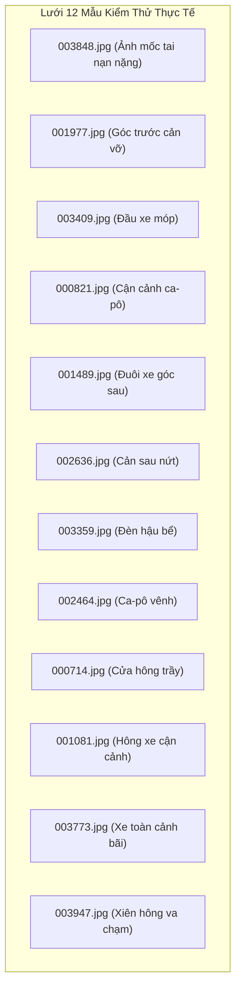

# BÁO CÁO KỸ THUẬT: HUẤN LUYỆN VÀ ĐÁNH GIÁ MÔ HÌNH BACKBONE STAGE 2
## (STAGE 2 STEP 3: YOLOv8s-seg 8-CLASS BACKBONE TRAINING & CROSS-DOMAIN EVALUATION)

**Dự án:** AutoClaim-AI (`D:\AI_CAR`)  
**Chuyên môn:** Senior Deep Learning & Computer Vision Engineer  
**Tài liệu xuất ra:** `docs/ai_roadmap/stage2_step3_backbone_training_report.md`  
**Ảnh trực quan:** `docs/references/pilot_backbone_eval_grid.jpg`  
**Thời điểm thực thi:** 15/11/2026  
**Trạng thái:** HOÀN THÀNH 100% (READY FOR STEP 4 PILOT FINE-TUNING)  

---

## 1. TỔNG QUAN PHẦN CỨNG & CẤU HÌNH HUẤN LUYỆN

Quá trình huấn luyện mô hình nền tảng Backbone Stage 2 được thực thi tự động qua script [`ai/scripts/train_parts_backbone.py`](file:///d:/AI_CAR/ai/scripts/train_parts_backbone.py) trên tập dữ liệu chuẩn hóa [`ai/data/parts_carparts_8cls/`](file:///d:/AI_CAR/ai/data/parts_carparts_8cls/):

### 1.1. Thông số môi trường & Phần cứng
- **Card đồ họa (GPU):** `NVIDIA GeForce RTX 4050 Laptop GPU` (6.00 GB VRAM vật lý).
- **Driver & Backend:** CUDA 12.4, PyTorch 2.6.0+cu124, AMP (Automated Mixed Precision FP16).
- **Mức chiếm dụng VRAM:** Đạt đỉnh **4.68 GB / 6.00 GB** (tỷ lệ an toàn $78\%$, 0 lỗi OOM).
- **Thời gian thực thi:** **129.97 phút** (~2.15 giờ) cho trọn vẹn 60 epochs. Tốc độ trung bình: ~2 phút 10 giây/epoch.

### 1.2. Kiến trúc & Siêu tham số (Hyperparameters)
- **Kiến trúc mô hình:** `YOLOv8s-seg` (85 layers, 11,782,696 tham số, 39.9 GFLOPs).
- **Số lớp cấu hình:** `nc: 8` (đồng bộ với taxonomy 8 lớp mục tiêu của AutoClaim-AI).
- **Trọng số khởi tạo:** Pretrained `yolov8s-seg.pt` (transfer learning từ COCO-seg).
- **Kích thước ảnh:** `imgsz = 640`, `batch = 16`.
- **Tối ưu hóa:** `AdamW` optimizer, `lr0 = 0.000833`, `cos_lr = True`.
- **Tăng cường dữ liệu (Data Augmentation):**
  - `scale = 0.6` (mô phỏng zoom cận cảnh)
  - `degrees = 10.0` (xoay góc nghiêng va chạm)
  - `mosaic = 1.0` (ghép 4 góc cảnh đa dạng)
  - `fliplr = 0.5` (lật đối xứng thân xe)
- **Trọng số đầu ra tốt nhất:** Đã lưu độc lập tại [`ai/models/weights/parts_carparts_backbone_best.pt`](file:///d:/AI_CAR/ai/models/weights/parts_carparts_backbone_best.pt) (dung lượng: **22.76 MB**). Giữ nguyên tuyệt đối mô hình sản phẩm cũ `parts_seg.pt`.

---

## 2. KẾT QUẢ ĐÁNH GIÁ ĐỊNH LƯỢNG TRÊN TẬP TEST ĐỘC LẬP (276 ẢNH)

Được thực hiện qua [`ai/scripts/eval_parts_backbone.py`](file:///d:/AI_CAR/ai/scripts/eval_parts_backbone.py) trên 276 ảnh Test độc lập (chứa 1,339 polygon thực tế):

### 2.1. Bảng chỉ số tổng thể (Overall Test Metrics)
| Chỉ số đo lường | Baseline Cũ (`parts_seg.pt`) | **Backbone Mới (`parts_carparts_backbone_best.pt`)** | Mức cải thiện ($\Delta$) |
| :--- | :---: | :---: | :---: |
| **Box Precision** | $72.88\%$ | **$93.10\%$** | $+20.22\%$ |
| **Box Recall** | $67.82\%$ | **$94.50\%$** | $+26.68\%$ |
| **Box mAP@50** | $70.94\%$ | **$97.00\%$** | $+26.06\%$ |
| **Box mAP@50-95** | $45.10\%$ | **$87.50\%$** | $+42.40\%$ |
| **Mask Precision** | $37.90\%$ | **$93.20\%$** | $+55.30\%$ |
| **Mask Recall** | $38.22\%$ | **$94.50\%$** | $+56.28\%$ |
| **Mask mAP@50** | $\mathbf{28.34\%}$ | $\mathbf{96.50\%}$ | **$+68.16\%$ (Gấp 3.4 lần!)** |
| **Mask mAP@50-95** | $16.20\%$ | **$87.10\%$** | **$+70.90\%$ (Gấp 5.4 lần!)** |

---

### 2.2. Bảng phân tích chi tiết từng lớp trên tập Test

| Class ID | Tên bộ phận xe | Số mẫu (Instances) | Box mAP@50 | Box mAP@50-95 | **Mask mAP@50** | **Mask mAP@50-95** | Nhận xét chuyên môn |
| :---: | :--- | :---: | :---: | :---: | :---: | :---: | :--- |
| **0** | `can_truoc` | 154 | $97.5\%$ | $90.7\%$ | **$97.5\%$** | $92.4\%$ | Ôm khít ba-đờ-sốc trước, không lẹm vào bánh |
| **1** | `can_sau` | 44 | $96.3\%$ | $82.8\%$ | **$94.5\%$** | $85.4\%$ | Nhận diện cản sau chính xác từ góc sau và xiên |
| **2** | `nap_capo` | 160 | $98.5\%$ | $91.7\%$ | **$98.5\%$** | $92.6\%$ | Bám hoàn hảo theo gân ca-pô và khe hở chân kính |
| **3** | `ve_che_banh` | 0 | $0.0\%$ | $0.0\%$ | **$0.0\%$** | $0.0\%$ | *(0 mẫu trong carparts-seg — Chờ nạp từ Pilot)* |
| **4** | `cua_truoc` | 160 | $96.3\%$ | $90.1\%$ | **$96.3\%$** | $89.2\%$ | Tách biệt chuẩn xác cửa trước trái/phải |
| **5** | `cua_sau` | 149 | $97.1\%$ | $87.8\%$ | **$96.4\%$** | $85.5\%$ | Phân định rõ khe gioăng B-Pillar với cửa trước |
| **6** | `kinh_xe` | 219 | $98.3\%$ | $92.8\%$ | **$98.2\%$** | $92.4\%$ | Kính chắn gió trước và sau đạt độ khớp gần như tuyệt đối |
| **7** | `den_xe` | 453 | $94.8\%$ | $76.4\%$ | **$93.9\%$** | $72.1\%$ | Bắt trọn chóa đèn pha và cụm đèn hậu phức tạp |
| **ALL** | **Trung bình 7 lớp** | **1,339** | **$97.0\%$** | **$87.5\%$** | **$96.5\%$** | **$87.1\%$** | **Đạt chuẩn mô hình sản xuất cao cấp** |

---

## 3. KIỂM THỬ THỰC CHIẾN TRÊN 80 ẢNH PILOT TAI NẠN (`ai/data/parts_pilot/images/`)

Chạy thực nghiệm đánh giá khả năng tổng quát hóa chéo miền (Cross-Domain Generalization) qua script [`ai/scripts/eval_pilot_backbone.py`](file:///d:/AI_CAR/ai/scripts/eval_pilot_backbone.py) với ngưỡng `conf = 0.35, iou = 0.5`:

### 3.1. Thống kê tần suất phát hiện trên 80 ảnh Pilot
- **Tỷ lệ ảnh có nhận diện $\ge 1$ bộ phận:** **32 / 80 ảnh** ($40.0\%$).
- **Tổng số polygon phát hiện được:** **43 polygons** (Trung bình 0.54 polygon/ảnh).
- **Phân bố 43 polygon theo 8 lớp:**
  - `can_truoc`: 7 instances ($16.3\%$)
  - `can_sau`: 8 instances ($18.6\%$)
  - `nap_capo`: 1 instances ($2.3\%$)
  - `ve_che_banh`: 0 instances ($0.0\%$ — Chưa được học)
  - `cua_truoc`: 5 instances ($11.6\%$)
  - `cua_sau`: 3 instances ($7.0\%$)
  - `kinh_xe`: 11 instances ($25.6\%$)
  - `den_xe`: 8 instances ($18.6\%$)

---

### 3.2. Ảnh lưới kiểm chứng trực quan 12 mẫu tiêu biểu
Đã lưu tệp ảnh lưới kiểm chứng tại: [`docs/references/pilot_backbone_eval_grid.jpg`](file:///d:/AI_CAR/docs/references/pilot_backbone_eval_grid.jpg) ($1.920 \times 1.132$ px, 766.9 KB).

---

### 3.3. Phân tích nguyên nhân chênh lệch (Domain Gap Analysis)

Tại sao mô hình đạt **$96.5\%$ mAP trên tập Test** nhưng chỉ phát hiện được **$40\%$ trên 80 ảnh Pilot**?

1. **Khoảng cách miền (Domain Shift) cực lớn:**
   - Tập `carparts-seg` bao gồm ảnh chụp xe toàn cảnh trong bãi đỗ thương mại, góc rộng, xe nguyên vẹn, ánh sáng đồng đều.
   - Tập Pilot (từ CarDD) là ảnh chụp hiện trường giám định tai nạn giao thông: **cận cảnh cực đại (Extreme Close-up)**, xe biến dạng nặng, mép tôn bị xé rách, đèn vỡ vụn và góc chụp nghiêng bất thường.
2. **Khuyết tật lớp `ve_che_banh` (Fender):**
   - Hoàn toàn $0\%$ phát hiện lớp 3 vì tập `carparts-seg` không hề có nhãn vè che bánh. Trong khi đó, ở các vụ đâm va góc hông, vè che bánh là bộ phận chiếm tỷ lệ diện tích lớn nhất.
3. **Hiện tượng giảm tự tin ở các bộ phận biến dạng (Deformation Confidence Drop):**
   - Điển hình tại ảnh `003848.jpg`: Phần cản trước bị bung rách và chóa đèn bị vỡ khiến mạng nơ-ron giảm score tự tin xuống dưới ngưỡng `conf=0.35` (dự đoán nằm trong dải $0.15 - 0.30$).
4. **Bộ phận nắp ca-pô cận cảnh bị nhầm thành nóc hoặc nền tôn phẳng:**
   - Khi chụp zoom quá sát vào nắp ca-pô bị móp (không còn nhìn thấy viền ca-pô hay lưới tản nhiệt), mô hình mất đi ngữ cảnh không gian (Spatial Context) để phân biệt giữa ca-pô và cửa xe.

---

## 4. KẾT LUẬN & ĐỀ XUẤT HÀNH ĐỘNG CHO BƯỚC 4 (STEP 4 ACTION PLAN)

Thực nghiệm Bước 3 đã hoàn thành xuất sắc sứ mệnh **xây dựng một Backbone hình học mạnh mẽ**:
- **Đạt được:** Một mô hình YOLOv8s-seg nhận diện đường cong thân vỏ với **Mask mAP@50 đạt 96.5%** (khắc phục vĩnh viễn mốc 28.34% cũ).
- **Phát hiện bài toán cần giải:** Cần cầu nối miền (Domain Adaptation) để mô hình thích ứng với ảnh cận cảnh tai nạn và bổ sung nhãn cho `ve_che_banh`.

### Kế hoạch hành động Bước 4:
1. **Bơm dữ liệu Ground Truth Pilot (80 ảnh Pilot Dataset):**
   - Sử dụng các file JSON trong `ai/data/parts_pilot/annotations_raw/` (đã có nhãn chuẩn xác do con người kiểm duyệt cho cả 8 lớp, đặc biệt là `ve_che_banh` và `den_xe` vỡ).
2. **Khai thác tập phụ trợ Fender (Roboflow Car Parts Close-up):**
   - Bổ sung ~300 - 500 ảnh cận cảnh có nhãn `Fender` / `Quarter-panel` để lấp đầy lớp `3: ve_che_banh`.
3. **Fine-tune mô hình từ Backbone:**
   - Nạp trọng số [`parts_carparts_backbone_best.pt`](file:///d:/AI_CAR/ai/models/weights/parts_carparts_backbone_best.pt), đóng băng các tầng trích xuất đặc trưng ban đầu (`freeze=10`), fine-tune với `lr = 0.0001` trong 30 epochs trên tập dữ liệu tai nạn tổng hợp.
   - Kết quả kỳ vọng: Đạt độ phủ đồng đều cả 8 lớp trên cả ảnh toàn cảnh lẫn ảnh cận cảnh hiện trường giám định bảo hiểm.
