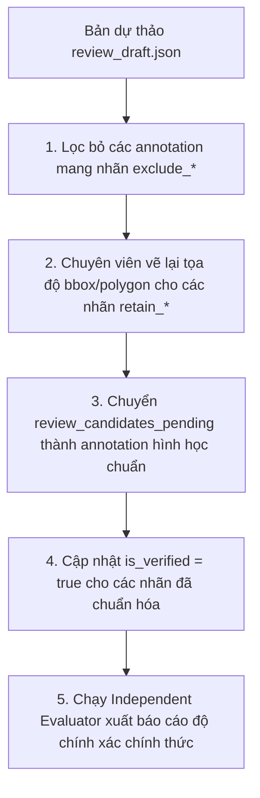

# 11 - KIỂM TRA TƯƠNG THÍCH BẢN DỰ THẢO GROUND TRUTH VỚI HỆ THỐNG ĐÁNH GIÁ (SPRINT 4B.1.1)

**Dự án:** AutoClaim-AI (`AI_CAR`)  
**Tài liệu kiểm tra:** `demo/annotations_ground_truth_review_draft.json`  
**Hệ thống đối soát:** `evaluation/evaluator.py` & `evaluation/run_evaluation.py`  
**Phương thức:** Rà soát tĩnh & kiểm thử tương thích Chỉ đọc (Read-Only)  
**Thời điểm thực hiện:** 2026-11-12T23:45:00+07:00  

---

## 1. TỔNG KẾT TRẠNG THÁI (VERDICT)

### Kết luận tổng thể: `BLOCKED` (Về mặt vận hành) kèm `WARNING` (Về mặt ngữ nghĩa & schema)

- **Vận hành (Operational): `BLOCKED`**  
  Tất cả 28 annotations (14 bộ phận, 14 tổn thất) trong bản dự thảo đều tiếp tục mang trạng thái `"is_verified": false` và `"verification_status": "pending_review"`. Theo đúng chính sách an toàn của `IndependentEvaluator`, việc chạy đánh giá bị **CHẶN TUYỆT ĐỐI** (`BLOCKED – INSUFFICIENT VERIFIED GROUND TRUTH`) nhằm ngăn chặn việc tạo ra các chỉ số accuracy giả mạo.
- **Cú pháp kỹ thuật (Syntactic Compatibility): `PASS`**  
  File JSON hợp lệ 100%, cấu trúc phân tầng gốc (`images -> parts_ground_truth / damages_ground_truth`) tương thích hoàn toàn với các hàm đọc dữ liệu của `evaluator.py`. Bộ nạp dữ liệu không bị crash hay phát sinh ngoại lệ cú pháp.
- **Ngữ nghĩa dữ liệu (Semantic Compatibility): `CRITICAL WARNING`**  
  Bản dự thảo bổ sung trường nghiệp vụ `review_action` (với các hành động loại trừ như `exclude_candidate_wrong_part`, `exclude_part_mapping_pending_context`, `possible_duplicate_merge_review`) và trường `review_candidates_pending` (dưới dạng mảng chuỗi ghi chú). Hiện tại `evaluator.py` **CHƯA ĐỌC** trường `review_action` và **KHÔNG THỂ NẠP** các ứng viên dạng chuỗi nếu không được chuyển đổi thành annotation hình học chuẩn.

---

## 2. ĐỐI CHIẾU SCHEMA: EVALUATOR YÊU CẦU vs. BẢN DỰ THẢO HIỆN CÓ

### 2.1. Bảng so sánh cấp độ File & Metadata (Root Level)

| Trường Dữ Liệu | Schema `evaluator.py` Yêu Cầu | Schema Trong Draft JSON | Mức Độ Tương Thích | Ghi Chú Kỹ Thuật |
| :--- | :--- | :--- | :---: | :--- |
| `images` | Bắt buộc (`List[Dict]`) | Có (`List[Dict]`, 8 items) | **PASS** | Evaluator lặp qua danh sách 8 ảnh chuẩn xác |
| `dataset_version` | Tùy chọn (`str`) | `1.0-sprint4b1-review-draft` | **PASS** | Metadata phục vụ truy xuất nguồn gốc |
| `verification_status` | Đọc để audit (`str`) | `pending_human_review` | **PASS** | Nhận diện đúng trạng thái toàn tập chưa duyệt |
| `review_revision` | Không yêu cầu | Có (`Dict`) | **PASS (Ignored)** | Chứa chính sách tọa độ & duyệt; Evaluator bỏ qua an toàn |

---

### 2.2. Bảng so sánh cấp độ Ảnh (Image Level)

| Trường Dữ Liệu | Schema `evaluator.py` Yêu Cầu | Schema Trong Draft JSON | Tương Thích | Ghi Chú Kỹ Thuật |
| :--- | :--- | :--- | :---: | :--- |
| `file_name` | Bắt buộc (`str`) | Khớp 8/8 tệp `demo/input/` | **PASS** | Khóa ánh xạ với `demo/results/predictions.json` |
| `image_id` | Tùy chọn (`int`, 1..8) | Có (`int`, 1..8) | **PASS** | Đánh số thứ tự duy nhất, không trùng lặp |
| `width`, `height` | Khuyến nghị (`int`) | Đầy đủ kích thước pixel thực tế | **PASS** | Dùng làm kích thước canvas tính Mask IoU |
| `is_verified` | Bắt buộc (`bool`) | `False` (8/8 ảnh) | **PASS** | Kích hoạt cờ an toàn, chặn đánh giá sớm |
| `verification_status` | Đọc để audit (`str`) | `pending_review` (8/8 ảnh) | **PASS** | Phục vụ thống kê tỷ lệ chờ duyệt |
| `parts_ground_truth` | Bắt buộc (`List[Dict]`) | Có (14 entries) | **PASS** | Danh sách bộ phận chuẩn hóa |
| `damages_ground_truth` | Bắt buộc (`List[Dict]`) | Có (14 entries) | **PASS** | Danh sách tổn thất chuẩn hóa |
| `review_candidates_pending` | **Không có trong schema** | Có (`List[str]`) | **WARNING** | Chứa ghi chú dạng văn bản; Evaluator bỏ qua, không tính vào nhãn |
| `review_summary` | Không có trong schema | Có (`str`) | **PASS (Ignored)** | Tóm tắt trực quan của chuyên viên; Evaluator bỏ qua an toàn |

---

### 2.3. Bảng so sánh cấp độ Bộ Phận (`parts_ground_truth`)

| Trường Dữ Liệu | Kiểu Dữ Liệu Evaluator Yêu Cầu | Draft JSON Cung Cấp | Tương Thích | Rủi Ro Kỹ Thuật / Ngữ Nghĩa |
| :--- | :--- | :--- | :---: | :--- |
| `part_id` | `int` | `int` | **PASS** | Khóa định danh bộ phận trong ảnh |
| `part_label` | `str` (chuẩn hóa về 8 lớp) | `str` (thuộc danh mục chuẩn) | **PASS** | Khớp hoàn toàn bảng `PART_NORMALIZATION` |
| `polygon` | `List[List[float]]` (>= 3 đỉnh) | `List[List[float]]` (4 - 56 đỉnh) | **PASS** | Đạt điều kiện vẽ mask tính Mask IoU |
| `bbox_xyxy` | `List[float]` (4 phần tử) | `List[float]` (4 phần tử) | **PASS** | Hộp bao hình học hợp lệ |
| `is_verified` | `bool` | `False` (14/14 nhãn) | **PASS** | Bộ lọc `verified_only` loại bỏ chính xác |
| `review_action` | **Chưa có trong Evaluator** | `str` (5 loại action) | **CRITICAL WARNING** | **Xem phân tích chi tiết tại Mục 3** |
| `review_notes` | Tùy chọn (`str`) | `str` | **PASS (Ignored)** | Ghi chú điều tra nguyên nhân sai lệch |

---

### 2.4. Bảng so sánh cấp độ Tổn Thất (`damages_ground_truth`)

| Trường Dữ Liệu | Kiểu Dữ Liệu Evaluator Yêu Cầu | Draft JSON Cung Cấp | Tương Thích | Rủi Ro Kỹ Thuật / Ngữ Nghĩa |
| :--- | :--- | :--- | :---: | :--- |
| `damage_id` | `int` | `int` | **PASS** | Khóa định danh tổn thất trong ảnh |
| `damage_type` | `str` (chuẩn hóa về 5 lớp) | `crack`, `scratch`, `dent` | **PASS** | Khớp hoàn toàn bảng `DAMAGE_NORMALIZATION` |
| `bbox_xyxy` | `List[float]` (4 phần tử) | `List[float]` (4 phần tử) | **PASS** | Tọa độ `[x1, y1, x2, y2]` hợp lệ |
| `true_part_name` | `str` (bộ phận vật lý) | `cua_truoc`, `den_xe`, v.v. | **PASS** | Khớp taxonomy hoặc gán `khong_xac_dinh` |
| `true_part_id` | `int` hoặc `None` | `int` hoặc `None` | **PASS** | Liên kết hợp lệ tới `part_id` trong cùng ảnh |
| `is_verified` | `bool` | `False` (14/14 nhãn) | **PASS** | Bộ lọc `verified_only` loại bỏ chính xác |
| `review_action` | **Chưa có trong Evaluator** | `str` (9 loại action) | **CRITICAL WARNING** | **Xem phân tích chi tiết tại Mục 3** |
| `review_notes` | Tùy chọn (`str`) | `str` | **PASS (Ignored)** | Ghi chú hướng dẫn vẽ lại / gộp hộp |

---

## 3. CÁC ĐIỂM KHÔNG TƯƠNG THÍCH VÀ RỦI RO KHI TÍCH HỢP

### Rủi ro 1: Lỗ hổng bỏ qua `review_action` (Semantic Leakage)
Trong bản dự thảo, chuyên viên giám định đã phân loại rất kỹ các hành động cần xử lý:
- **6 bộ phận bị đánh dấu loại trừ:**
  - Ảnh #5: `cua_truoc`, `nap_capo`, `kinh_xe` (Đều gán `exclude_candidate_wrong_part` do AI nhận diện sai góc thân xe phía sau).
  - Ảnh #7: `kinh_xe` (Gán `exclude_candidate_wrong_part` do AI nhận nhầm cụm đèn trước thành kính xe).
  - Ảnh #8: `can_truoc` (Gán `exclude_candidate_wrong_part` do AI nhận nhầm cửa hông xe thành cản trước).
  - Ảnh #2: `nap_capo` (Gán `exclude_candidate_unless_confirmed`).
  - Ảnh #4 & #6: `can_truoc`, `ve_che_banh` (Gán `exclude_part_mapping_pending_context` do góc macro).
- **Hạn chế của Evaluator hiện tại:**  
  `evaluator.py` chỉ lọc theo điều kiện: `[p for p in gt_parts if p.get('is_verified', False)]`.  
  **Nếu người dùng sơ suất chuyển toàn bộ `"is_verified": true` mà không loại bỏ các nhãn `exclude_*`, Evaluator sẽ tính cả các nhãn sai này vào Ground Truth**, dẫn đến việc phạt sai mô hình AI hoặc đo lường sai lệch nghiêm trọng.

### Rủi ro 2: Bất đối xứng giữa tọa độ nguyên bản và hành động điều chỉnh (Unmodified Coordinates)
Chính sách của bản dự thảo ghi rõ:  
`"coordinate_policy": "Không tự tạo hoặc sửa bbox/polygon; giữ nguyên tọa độ ban đầu để tránh đoán biên từ ảnh ghép."`
- Điều này có nghĩa là các tổn thất được đánh dấu `retain_candidate_split_box` (Ảnh #1 vệt xước cản khổng lồ), `retain_candidate_redraw_box` (Ảnh #1, #2, #4, #7), hay `possible_duplicate_merge_review` (Ảnh #8 có 2 vết móp trùng nhau) **VẪN ĐANG GIỮ NGUYÊN TỌA ĐỘ THÔ BAN ĐẦU**.
- Do đó, dù các hộp này có được gắn nhãn `retain_candidate`, chúng vẫn chưa đạt tiêu chuẩn hình học để làm Ground Truth đánh giá định lượng.

### Rủi ro 3: Ứng viên bổ sung không có tọa độ (`review_candidates_pending`)
- Bản dự thảo ghi nhận các ứng viên bị AI bỏ sót dưới dạng văn bản trong `review_candidates_pending`:
  - Ảnh #1 & #7: Đèn xe (`den_xe`) bị vỡ nhưng model seg không có class này.
  - Ảnh #3: Vết xước (`scratch`) ở vòm bánh xe bị AI bỏ sót.
  - Ảnh #8: Bộ phận cánh cửa (`cua_truoc`) phù hợp hơn `can_truoc`.
- Các ứng viên này **chưa có tọa độ `polygon` hay `bbox_xyxy`**, nên `evaluator.py` không thể tự động đưa vào tính toán False Negative (FN).

---

## 4. BẢNG PHÂN LOẠI ĐIỀU KIỆN CỦA 28 ANNOTATION HIỆN CÓ

| Nhóm Annotation | Số Lượng | Trạng Thái Thẩm Định | Tình Trạng Đủ Điều Kiện Đánh Giá |
| :--- | :---: | :---: | :--- |
| **Nhãn bộ phận hợp lệ (Cần chỉnh viền)** | 6 | `pending_review` | **Chưa đủ điều kiện:** Cần vẽ lại viền polygon chính xác trên ảnh gốc trước khi duyệt. |
| **Nhãn bộ phận sai / thiếu context (`exclude_*`)** | 8 | `pending_review` | **KHÔNG ĐƯỢC ĐƯA VÀO ĐÁNH GIÁ:** Cần loại bỏ khỏi tập Ground Truth chính thức. |
| **Nhãn tổn thất hợp lệ (Cần vẽ lại / chia nhỏ box)** | 8 | `pending_review` | **Chưa đủ điều kiện:** Tọa độ hiện tại quá rộng; cần chuyên viên vẽ lại box ôm sát. |
| **Nhãn tổn thất trùng lặp / nghi ngờ (`review_or_exclude`)** | 6 | `pending_review` | **Chưa đủ điều kiện:** Cần xác nhận có phải tổn thất thật hay chỉ là bóng đổ / thiết kế xe. |
| **TỔNG CỘNG** | **28** | **0% Verified** | **0 / 28 annotation đủ điều kiện chạy Evaluator chính thức** |

---

## 5. DANH SÁCH CÁC VIỆC CẦN LÀM TRƯỚC KHI CHẠY EVALUATOR

Để hoàn tất việc chuyển giao từ bản dự thảo sang bộ dữ liệu đánh giá chính thức, cần thực hiện tuần tự 4 bước kỹ thuật sau:

1. **Bước 1 — Thanh lọc nhãn sai (Filtering):**  
   Loại bỏ hoàn toàn các bộ phận có `review_action: "exclude_candidate_wrong_part"` (Ví dụ: `can_truoc` trong Ảnh #8, `kinh_xe` trong Ảnh #7, 3 bộ phận trong Ảnh #5).
2. **Bước 2 — Định biên tọa độ chuẩn (Coordinate Redrawing):**  
   - Chia nhỏ hộp bao `d2` trong Ảnh #1 thành các hộp xước ôm sát bám theo vết xước cản.
   - Hợp nhất 2 hộp `dent` trùng lặp trong Ảnh #8 thành 1 hộp tổn thất duy nhất.
   - Thu gọn các hộp bao bị rộng trong Ảnh #2, #4, #7.
3. **Bước 3 — Bổ sung nhãn khuyết (Missing Annotations):**  
   Tạo tọa độ bbox cho vết xước trong Ảnh #3 và polygon cho `den_xe` trong Ảnh #1, #7.
4. **Bước 4 — Nâng cấp tính năng cho `evaluator.py` (Khuyến nghị):**  
   Bổ sung logic nhận biết trường `review_action`: tự động bỏ qua các annotation có tiền tố `exclude_` ngay cả khi người dùng sơ suất đánh dấu `is_verified: true`.
5. **Bước 5 — Ký duyệt chính thức:**  
   Chuyển `"is_verified": true` và `"verification_status": "verified"` trên tập dữ liệu đã hoàn thiện, sau đó kích hoạt `python evaluation/run_evaluation.py`.
