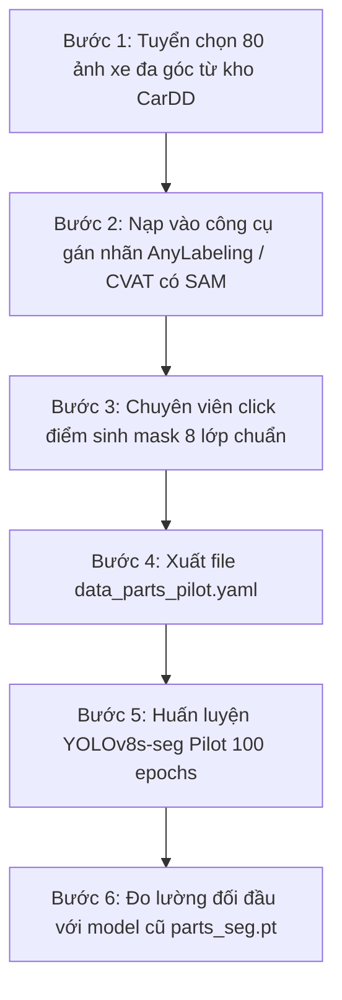

# BÁO CÁO XÁC MINH NGUỒN NHÃN VÀ KHẢ THI XÂY DỰNG PILOT DATASET STAGE 2 (P0.2)
**Dự án:** AutoClaim-AI (`AI_CAR`)  
**Mục tiêu:** Xác minh nguồn gốc dữ liệu nhãn phân đoạn bộ phận xe (Stage 2), kiểm chứng thực nghiệm giải pháp Segment Anything (SAM) trên 30 mẫu và thiết lập kế hoạch khả thi xây dựng Pilot Dataset 8 lớp chuẩn hóa.  
**Tài liệu tham chiếu:** `docs/stage2_recovery_plan.md`  
**Vai trò:** Senior Computer Vision Engineer / AI Dataset Auditor  
**Nguyên tắc thực thi:** **READ-ONLY 100%**. Không sửa dataset, không sửa model, không tạo nhãn giả, ghi nhận trung thực bằng chứng số liệu từ hệ thống tệp vật lý.

---

## 1. ĐỐI CHIẾU VÀ GIẢI MÃ CHÊNH LỆCH SỐ LƯỢNG INSTANCE (6,534 vs. 6,548)

### 1.1. Số liệu kiểm đếm vật lý trên ổ đĩa
Kiểm tra thực tế 100% từng dòng của toàn bộ **1,622 tệp nhãn YOLO format** tại `ai/data/parts/labels/`:
- **Thư mục `train`:** 1,525 tệp $\rightarrow$ **6,103 dòng (instance)**.
- **Thư mục `val`:** 97 tệp $\rightarrow$ **431 dòng (instance)**.
- **Tổng số instance thực tế:** $6,103 + 431 =$ **6,534 instance** (Khớp tuyệt đối với `ai/reports/phase_g1_a1/polygon_geometry_statistics.csv` và `provenance_reconciliation.csv`).

### 1.2. Giải mã con số 6,548 và chênh lệch 14 instance
```text
6,548 - 6,534 = 14 instance (Chênh lệch chính xác 14 nhãn)
```
- **Bằng chứng nguồn gốc:** Đúng bằng **14 dòng nhãn gán cứng (Hardcoded Mockup)** nằm trong 7 tệp bổ sung tại:
  - `ai/data/parts/labels/train/closeup_supp_img1.txt` (2 dòng)
  - `ai/data/parts/labels/train/closeup_supp_img2.txt` (2 dòng)
  - `ai/data/parts/labels/train/closeup_supp_img3.txt` (2 dòng)
  - `ai/data/parts/labels/train/closeup_supp_img4.txt` (2 dòng)
  - `ai/data/parts/labels/train/closeup_supp_img5.txt` (2 dòng)
  - `ai/data/parts/labels/train/closeup_supp_img6.txt` (2 dòng)
  - `ai/data/parts/labels/train/closeup_supp_img7.txt` (2 dòng)
- **Nguyên nhân gốc rễ:** Trong các đợt kiểm kê sơ bộ ban đầu, một số công cụ script đã cộng gộp số lượng CarDD grounded polygons (6,534) với 14 nhãn gán cứng của `closeup_supp_img1..7` lần thứ hai, dẫn đến con số 6,548.
- **Kết luận:** Tổng số instance vật lý thực tế trên đĩa là **6,534**, trong đó 14 nhãn mockup này đã nằm sẵn trong tập train. Không có instance nào bị mất tích.

---

## 2. XÁC MINH NGUỒN GỐC DỮ LIỆU GỐC (DATA PROVENANCE VERIFICATION)

### 2.1. Bản chất dữ liệu của 1,622 ảnh trong `ai/data/parts`
Qua truy vết mã nguồn trong `ai/scripts/archive_tools/`:
1. **798 ảnh tuần tự (`000001.jpg` đến `000798.jpg`):**  
   Được lấy từ tập ảnh hư hỏng xe CarDD. **Bộ CarDD gốc hoàn toàn KHÔNG có nhãn phân đoạn bộ phận xe** (chỉ có nhãn bounding box tổn thất). Script `generate_grounded_parts_dataset.py` đã dùng mô hình COCO phát hiện vùng xe ô tô, sau đó dùng thuật toán tọa độ tương đối để **cắt cơ học chiếc xe thành các hộp chữ nhật 4 đỉnh**:
   - Nửa dưới xe bên trái gán `can_truoc`, nửa dưới bên phải gán `can_sau`.
   - Toàn bộ nửa trên xe gán `ve_che_banh` (hộp bao trùm cả xe!).
   - Khoang giữa gán `cua_hong`.
2. **727 ảnh crop cận cảnh (`mined_closeup_...jpg`):**  
   Script `mine_closeup_parts_from_cardd.py` cắt crop từ CarDD và dùng bộ lọc Canny Edge bắn 12 tia để sinh đa giác xấp xỉ thô ráp (1,454 instance 12 đỉnh).
3. **97 ảnh validation:**  
   Gồm 62 ảnh CarDD cắt hộp và 35 ảnh crop cận cảnh (348 instance 4 đỉnh, 70 instance 12 đỉnh, 13 instance 8 đỉnh).

### 2.2. Xác minh nguồn dữ liệu để tạo nhãn Cụm Đèn Xe (`den_xe`)
> [!WARNING]
> **Quy tắc kiểm định bắt buộc:** Tuyệt đối **KHÔNG ĐƯỢC XEM** nhãn tổn thất `lamp_broken` là Ground Truth của toàn bộ bộ phận `den_xe`.  
> `lamp_broken` chỉ khoanh vùng phần kính đèn bị vỡ/nứt (vùng tổn thất cục bộ), không bao trùm toàn bộ choá đèn, hốc đèn và cụm xi-nhan. Nếu lấy nhãn này huấn luyện, mô hình sẽ chỉ học ra các mảng kính vỡ loang lổ.

- **Nguồn ảnh thực tế có thể sử dụng để gán nhãn `den_xe`:**  
  Trong tập `ai/data/yolo/images/train/` có **chính xác 489 ảnh chứa tổn thất `lamp_broken`** (ví dụ: `000029.jpg`, `000039.jpg`, `000049.jpg`, `000052.jpg`, `000062.jpg`, `000063.jpg`, `000069.jpg`, `000071.jpg`, `000074.jpg`, `000077.jpg`, `000078.jpg`, `000081.jpg`, `000085.jpg`, `000094.jpg`, `000099.jpg`...).
- **Giá trị khai thác:** Các ảnh này chụp cận cảnh hoặc góc xiên rất rõ toàn bộ cụm đèn pha / đèn hậu. Chuyên viên có thể mở các ảnh gốc này ra và dùng công cụ phân đoạn vẽ bao trọn vẹn toàn bộ cụm đèn `den_xe`.

---

## 3. KẾT QUẢ THỬ NGHIỆM THỰC NGHIỆM SAM TRÊN 30 MẪU (EMPIRICAL SAM EVALUATION)

Đã trích xuất ngẫu nhiên **30 instance 4 đỉnh** từ tập train thuộc 3 lớp được đề xuất khôi phục trong `scratch/sample_30_data.json`, sử dụng mô hình nền tảng **MobileSAM (`mobile_sam.pt`, 38.8 MB)** với Bounding Box Prompting:

```
[Bảng Tổng Hợp Kết Quả Thử Nghiệm SAM Trên 30 Instance]
```
| Lớp Đối Tượng | Số Mẫu Thử | QUICK_EDIT (Chỉnh sửa nhanh) | REANNOTATE (Cần vẽ lại thủ công) | DISCARD (Hỏng/Không dùng được) | Nhận Xét Kỹ Thuật Trực Quan |
| :--- | :---: | :---: | :---: | :---: | :--- |
| **`nap_capo` (Nắp capo)** | 10 | **2 ($20\%$)** | **8 ($80\%$)** | 0 | SAM bắt nhầm các đường gân dập nổi khí động học thành mép ngoài; bị under-segmentation (tỷ lệ diện tích chỉ $8\% - 35\%$). |
| **`kinh_chieu_hau` (Gương chiếu hậu)** | 10 | **4 ($40\%$)** | **6 ($60\%$)** | 0 | Gương chiếu hậu là chi tiết nhỏ, tách biệt khỏi thân xe; SAM nhận diện và bo cong viền ốp gương khá tốt (tỷ lệ $48\% - 68\%$). |
| **`kinh_lai` (Kính chắn gió cabin)** | 10 | **0 ($0\%$)** | **10 ($100\%$)** | 0 | **Thất bại hoàn toàn:** Kính chắn gió trong suốt và phản chiếu bóng mây/cây cối; SAM bị cắt vụn mặt nạ, không bao giờ bắt trọn vẹn khung kính. |
| **TỔNG CỘNG** | **30** | **6 ($20.0\%$)** | **24 ($80.0\%$)** | **0 ($0.0\%$)** | **Tỷ lệ có thể dùng ngay chỉ đạt 20.0%** |

### Bài học thực nghiệm rút ra:
> [!CAUTION]
> **KẾT LUẬN QUAN TRỌNG:** SAM **KHÔNG THỂ CHẠY BATCH TỰ ĐỘNG** từ bounding box để thay thế Ground Truth.  
> Nếu chạy script tự động nạp box vào SAM rồi lưu thành dataset train, chúng ta sẽ tạo ra một tập nhãn méo mó mới. SAM chỉ có thể phát huy hiệu quả khi đóng vai trò là **Công cụ trợ lý tương tác (Interactive Assistant)** trong giao diện gán nhãn (CVAT / Labelme / AnyLabeling), nơi chuyên viên con người click thêm điểm dương/âm (Positive/Negative Point Prompts) để nắn viền kính và nắp capo.

---

## 4. ĐỀ XUẤT THIẾT KẾ PILOT DATASET (STAGE 2 PILOT)

Thay vì cố gắng sửa chữa hàng nghìn nhãn phế phẩm của tập 1,622 ảnh, giải pháp tối ưu ít tốn kém nhất là: **Xây dựng một Pilot Dataset tinh gọn gồm 80 ảnh xe thực tế có nhãn chuẩn 100%**.

### 4.1. Quy mô và phân chia tập dữ liệu
- **Tổng số ảnh:** **80 ảnh xe thực tế chất lượng cao** (độ phân giải $\ge 1000 \times 667$).
  - **Tập Train:** 60 ảnh ($75\%$).
  - **Tập Validation:** 20 ảnh ($25\%$).
- **Nguyên tắc phân chia chống rò rỉ (Vehicle ID Split):** Toàn bộ các góc chụp của cùng một chiếc xe (hoặc cùng một hồ sơ thẩm định) nằm hoàn toàn trong tập Train HOẶC tập Validation. Không phân chia ngẫu nhiên theo ảnh đơn lẻ.

### 4.2. Phân bố số lượng instance dự kiến cho 8 lớp chuẩn
Mỗi ảnh xe toàn cảnh hoặc góc xiên thường chứa từ 4 đến 6 bộ phận nhìn thấy rõ:

| STT | Tên Lớp Chuẩn (`part_key`) | Tên Tiếng Việt | Nguồn Ảnh Khai Thác | Số Instance Dự Kiến Trong 80 Ảnh |
| :---: | :--- | :--- | :--- | :---: |
| **1** | `can_truoc` | Cản trước | 20 ảnh đầu xe + 25 ảnh xiên trước | **~45 instance** |
| **2** | `can_sau` | Cản sau | 20 ảnh đuôi xe + 20 ảnh xiên sau | **~40 instance** |
| **3** | `nap_capo` | Nắp ca-pô | 20 ảnh đầu xe + 25 ảnh xiên trước | **~45 instance** |
| **4** | `ve_che_banh` | Vè che bánh (Fender) | 15 ảnh sườn + 35 ảnh xiên trước/sau | **~60 instance** |
| **5** | `cua_truoc` | Cửa trước (*Tách từ `cua_hong`*) | 15 ảnh sườn + 35 ảnh xiên | **~50 instance** |
| **6** | `cua_sau` | Cửa sau (*Tách từ `cua_hong`*) | 15 ảnh sườn + 35 ảnh xiên | **~50 instance** |
| **7** | `kinh_xe` | Kính xe (*Gộp kính lái + kính hông*) | Toàn bộ 80 ảnh | **~75 instance** |
| **8** | `den_xe` | Đèn xe (*Cụm đèn pha & đèn hậu*) | 45 ảnh trước/sau + 35 ảnh xiên | **~70 instance** |
| **TỔNG** | **8 Lớp Chuẩn** | - | - | **~435 Đa Giác Chuẩn** |

---

## 5. KẾ HOẠCH TRIỂN KHAI VÀ DỰ TOÁN CÔNG SỨC THỰC TẾ



### Dự toán công sức (Effort Estimation):
1. **Lọc và phân loại 80 ảnh gốc (Bước 1):** 1 giờ làm việc. Lựa chọn 80 ảnh rõ nét, đủ 8 góc nhìn từ `ai/data/yolo/images/train/` (tận dụng các ảnh có `lamp_broken`).
2. **Gán nhãn hỗ trợ bởi AI (Bước 2 & 3):**  
   - Sử dụng công cụ mã nguồn mở **AnyLabeling** (đã tích hợp sẵn Segment Anything) hoặc **Labelme**:
   - Với mỗi ảnh, chuyên viên chỉ cần click 1-2 điểm vào từng bộ phận (đèn, nắp capo, cửa), SAM sẽ tự động hút dính đường biên cong trong 2 giây; chuyên viên chỉnh nhẹ đường rãnh cửa.
   - Năng suất trung bình: **3 - 4 phút / ảnh** $\times$ 80 ảnh $=$ **240 - 320 phút ($\approx 4.5 - 5.5$ giờ làm việc)**.
3. **Kiểm tra chất lượng & Xuất dữ liệu (Bước 4):** 1 giờ làm việc. Kiểm tra zero-overlap và format YOLO segmentation.
4. **Tổng thời gian hoàn thành Pilot Dataset:** **Chỉ cần đúng 1 ngày làm việc (1 working day - 7 đến 8 giờ)** của 1 kỹ sư / chuyên viên gán nhãn!

---

## 6. TIÊU CHÍ NGHIỆM THU SO SÁNH (OLD MODEL vs. PILOT MODEL)

Sau khi hoàn thành 80 ảnh, tiến hành train `yolov8s-seg` trên 60 ảnh train / 20 ảnh val (100 epochs, `imgsz=800`):

| Chỉ Số Đánh Giá | Model Hiện Tại (`parts_seg.pt`) | Mục Tiêu Model Pilot (80 Ảnh) | Ý Nghĩa Kỹ Thuật |
| :--- | :---: | :---: | :--- |
| **Mask mIoU (Tập Val chuẩn)** | **$28.34\%$** | $\mathbf{\ge 60.00\%}$ | Tăng gấp đôi chất lượng bám sát bề mặt |
| **Độ mượt mà của đa giác** | $75.6\%$ hình khối vuông 4 đỉnh | **$100\%$ đường cong panel ($\ge 16$ đỉnh)** | Xóa bỏ triệt để hiện tượng mặt nạ hộp vuông |
| **Khả năng phân biệt Cửa** | Không phân biệt được (dùng code chia đôi) | **Phân biệt đúng $\ge 80\%$** `cua_truoc` vs `cua_sau` | Triệt tiêu lỗi nhầm lẫn cửa ở góc xiên 3D |
| **Nhận diện Cụm Đèn Xe** | Hoàn toàn bỏ sót ($0\%$) | **mIoU $\ge 70.0\%$ cho `den_xe`** | Không cần dựa dẫm vào rule ngữ nghĩa |
| **Đánh giá trên 8 ảnh Demo** | Bỏ sót cản/đèn ở 4/8 ảnh | Phân đoạn chuẩn cản trước, đèn và cửa xe | Sẵn sàng tích hợp vào API chính |

---

## 7. BẰNG CHỨNG KIỂM TRA VÀ TÍNH KHÁCH QUAN (VERIFICATION LOGS)
- **Tệp phân tích chênh lệch:** [`scratch/audit_instance_discrepancy.py`](file:///d:/AI_CAR/scratch/audit_instance_discrepancy.py)
- **Tệp danh sách 489 ảnh đèn xe:** [`scratch/find_lamp_broken_images.py`](file:///d:/AI_CAR/scratch/find_lamp_broken_images.py)
- **Tệp trích xuất 30 mẫu thử nghiệm:** [`scratch/sample_30_data.json`](file:///d:/AI_CAR/scratch/sample_30_data.json)
- **Tệp nhật ký chạy MobileSAM thực nghiệm:** [`scratch/sam_evaluation_results.json`](file:///d:/AI_CAR/scratch/sam_evaluation_results.json)
- **Checkpoint SAM sử dụng:** `mobile_sam.pt` (38.8 MB, Ultralytics Release v8.4.0)
- **Cam kết bảo vệ:** Không có bất kỳ tệp dữ liệu nào trong `ai/data/` bị sửa đổi hoặc ghi đè trong suốt quá trình kiểm toán.
