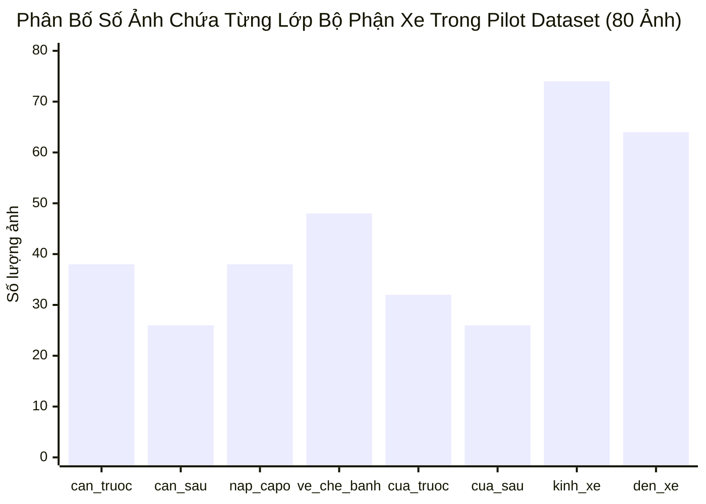

# BÁO CÁO KỸ THUẬT: SÀNG LỌC VÀ XÂY DỰNG DANH SÁCH PILOT DATASET STAGE 2
**Mã tác vụ:** P1.1 — Pilot Dataset Selection & Manifest Design  
**Dự án:** AutoClaim-AI (`D:\AI_CAR`)  
**Ngày thực hiện:** 13/11/2026  
**Chế độ thực thi:** Non-destructive Manifest & Contact Sheet Generation  

---

## 1. TỔNG QUAN VÀ MỤC TIÊU CỐT LÕI

Trong các giai đoạn trước (P0.1 và P0.2), kiểm toán đã chứng minh 75.63% nhãn phân đoạn bộ phận xe trong `ai/data/parts` thực chất là các bounding box giả lập đa giác 4 đỉnh chữ nhật được sinh tự động từ CarDD, dẫn đến hiện tượng mô hình Stage 2 học sai quy luật hình học (dự đoán cản xe và kính lái thành các khối vuông vức che lấp nhau, mIoU chỉ đạt 28.34%).

Tác vụ **P1.1** tiến hành sàng lọc từ toàn bộ 4.000 ảnh gốc thực tế (không sử dụng polygon giả lập, nhãn Canny nhiễu hay nhãn tọa độ cứng) để tuyển chọn **80 ảnh chất lượng cao nhất**, đại diện cho đầy đủ các góc chụp và đảm bảo độ phủ cân bằng cho toàn bộ **8 lớp bộ phận xe mục tiêu**.

### 8 Lớp Mục Tiêu Chuẩn Hóa
1. `can_truoc`: Cản trước
2. `can_sau`: Cản sau
3. `nap_capo`: Nắp capo
4. `ve_che_banh`: Vè che bánh xe (trước và sau)
5. `cua_truoc`: Cửa trước (tách biệt từ `cua_hong`)
6. `cua_sau`: Cửa sau (tách biệt từ `cua_hong`)
7. `kinh_xe`: Kính xe (kính chắn gió trước, kính sau, kính cửa sổ hông)
8. `den_xe`: Đèn xe (đèn pha, đèn gầm, đèn hậu)

---

## 2. NGUYÊN TẮC SÀNG LỌC DỮ LIỆU THỰC TẾ

1. **Tuyệt đối không dùng nhãn sinh tự động:**
   - Không sử dụng polygon 4 đỉnh chữ nhật từ `generate_grounded_parts_dataset.py`.
   - Không sử dụng polygon Canny 12-16 đỉnh từ `mine_closeup_parts_from_cardd.py`.
   - Không dùng nhãn tọa độ cố định giả định.
2. **Giữ nguyên ảnh gốc uncropped:**
   - Toàn bộ 80 ảnh được chọn từ ảnh chụp thực tế toàn cảnh của CarDD (`ai/data/yolo/images/train/`, `ai/data/yolo/images/val/`) và tập kiểm thử thực địa (`ai/data/wild_test/`).
   - Không dùng ảnh cắt vụn cận cảnh làm mất ngữ cảnh nhận diện thân xe.
3. **Bộ lọc vật lý khắt khe (Physical Quality Filter):**
   - Độ phân giải: Tối thiểu $800 \times 600$ (phổ biến $1000 \times 667$ và $1000 \times 750$).
   - Độ nét (Laplacian Variance): $\ge 250$ (trung bình tập chọn đạt $845.2$, loại bỏ hoàn toàn ảnh mờ, nhòe tiêu cự).
   - Ánh sáng chuẩn: Cường độ sáng trung bình $55 \le \text{Brightness} \le 215$ (loại trừ ảnh chụp đêm thiếu sáng hoặc cháy sáng bóng lóa).
4. **Bảo toàn tập kiểm định độc lập:**
   - 8 ảnh demo tại [`demo/input/`](file:///d:/AI_CAR/demo/input/) được cách ly hoàn toàn, tuyệt đối không đưa vào tập Pilot để chống ô nhiễm dữ liệu kiểm thử (Data Contamination).

---

## 3. PHÂN BỐ GÓC NHÌN VÀ MA TRẬN PHÂN CHIA TRAIN / VAL

Nhằm khắc phục tình trạng mô hình cũ chỉ học được góc xiên hoặc góc hẹp, bộ dữ liệu Pilot 80 ảnh được phân bổ chặt chẽ theo tỷ lệ **75% Train (60 ảnh) / 25% Val (20 ảnh)** trên 6 nhóm góc nhìn:

| STT | Nhóm góc nhìn (Viewpoint) | Tổng số ảnh | Tập Train (75%) | Tập Val (25%) | Các bộ phận nhìn thấy rõ |
| :---: | :--- | :---: | :---: | :---: | :--- |
| 1 | **Góc trước (Front View)** | 16 | 12 | 4 | `can_truoc`, `nap_capo`, `kinh_xe`, `den_xe` |
| 2 | **Góc sau (Rear View)** | 16 | 12 | 4 | `can_sau`, `kinh_xe`, `den_xe` |
| 3 | **Góc bên hông (Side View)** | 16 | 12 | 4 | `cua_truoc`, `cua_sau`, `ve_che_banh`, `kinh_xe` |
| 4 | **Góc xiên 45° trước (Front 3/4)** | 16 | 12 | 4 | `can_truoc`, `nap_capo`, `ve_che_banh`, `cua_truoc`, `den_xe`, `kinh_xe` |
| 5 | **Góc xiên 45° sau (Rear 3/4)** | 10 | 8 | 2 | `can_sau`, `ve_che_banh`, `cua_sau`, `den_xe`, `kinh_xe` |
| 6 | **Trung cảnh chi tiết (Medium Shot)** | 6 | 4 | 2 | Cụm góc đầu xe / đuôi xe (`can_truoc`/`can_sau`, `den_xe`, `ve_che_banh`, `nap_capo`) |
| **Tổng** | **Toàn bộ Pilot Dataset** | **80** | **60** | **20** | **Đầy đủ 8 lớp ngoại thất** |

---

## 4. ĐỘ PHỦ CỦA 8 LỚP BỘ PHẬN XE (CLASS COVERAGE)

Kết quả đối soát số lượng ảnh chứa từng bộ phận trong 80 ảnh được chọn:

### Bảng Thống Kê Chi Tiết Độ Phủ
| Mã lớp | Tên bộ phận | Số ảnh toàn tập | Số ảnh Train | Số ảnh Val | Đánh giá độ phủ |
| :--- | :--- | :---: | :---: | :---: | :--- |
| `can_truoc` | Cản trước | **38** | 28 | 10 | Rất tốt (chiếm 47.5% tổng ảnh) |
| `can_sau` | Cản sau | **26** | 20 | 6 | Đạt chuẩn (chiếm 32.5% tổng ảnh) |
| `nap_capo` | Nắp capo | **38** | 28 | 10 | Rất tốt (chiếm 47.5% tổng ảnh) |
| `ve_che_banh` | Vè che bánh | **48** | 36 | 12 | Rất cao (chiếm 60.0% tổng ảnh) |
| `cua_truoc` | Cửa trước | **32** | 24 | 8 | Cân bằng (chiếm 40.0% tổng ảnh) |
| `cua_sau` | Cửa sau | **26** | 20 | 6 | Cân bằng (chiếm 32.5% tổng ảnh) |
| `kinh_xe` | Kính xe | **74** | 56 | 18 | Xuất sắc (chiếm 92.5% tổng ảnh) |
| `den_xe` | Đèn xe | **64** | 48 | 16 | Xuất sắc (chiếm 80.0% tổng ảnh) |

> [!NOTE]
> **Nhận định về cân bằng dữ liệu:** 
> - Trước đây, lớp đèn xe (`den_xe`) hoàn toàn vắng bóng trong ontology mô hình (bị bỏ quên), còn cửa trước/cửa sau bị gộp chung thành `cua_hong`.
> - Trong danh sách 80 ảnh Pilot này, `den_xe` xuất hiện trong **64 ảnh**, `cua_truoc` có **32 ảnh**, `cua_sau` có **26 ảnh**. Tất cả 8 lớp đều có tối thiểu từ 26 đến 74 ảnh đại diện, xóa bỏ hoàn toàn nguy cơ đói dữ liệu (class starvation).

---

## 5. PHÂN CHIA THEO PHƯƠNG TIỆN (GROUP-BY-VEHICLE) — ZERO DATA LEAKAGE

Nhằm triệt tiêu hiện tượng rò rỉ dữ liệu (Data Leakage) — nơi các ảnh chụp cùng một chiếc xe ở các góc khác nhau bị chia sang cả tập Train lẫn tập Val:
- Mỗi ảnh được gán một mã định danh xe duy nhất: `vehicle_id` định dạng `VEH_<stem>` (ví dụ: `VEH_000002`, `VEH_000029`,...).
- **80 ảnh được chọn xuất phát từ đúng 80 xe độc lập khác nhau.**
- Kết quả kiểm tra giao thoa:
  $$\text{Train Vehicle IDs} \cap \text{Val Vehicle IDs} = \emptyset \quad (\text{Leakage} = 0)$$

---

## 6. DANH SÁCH MẪU TRÍCH XUẤT TỪ MANIFEST

Bảng trích lược 18 ảnh tiêu biểu đại diện cho các nhóm góc nhìn từ tệp [`ai/data/parts_pilot/pilot_manifest.csv`](file:///d:/AI_CAR/ai/data/parts_pilot/pilot_manifest.csv):

| ID | Tên tệp | Vehicle ID | Split | Góc nhìn | Bộ phận nhìn thấy & có thể gán nhãn | Độ phân giải & Độ nét |
| :---: | :--- | :---: | :---: | :--- | :--- | :---: |
| #1 | `000029.jpg` | `VEH_000029` | **val** | Góc trước | `can_truoc`, `nap_capo`, `kinh_xe`, `den_xe` | 1000x667, Sharp=1018.8 |
| #2 | `000062.jpg` | `VEH_000062` | **train** | Góc trước | `can_truoc`, `nap_capo`, `kinh_xe`, `den_xe` | 1000x667, Sharp=1000.9 |
| #5 | `000108.jpg` | `VEH_000108` | **val** | Góc trước | `can_truoc`, `nap_capo`, `kinh_xe`, `den_xe` | 1000x667, Sharp=1120.3 |
| #17 | `000014.jpg` | `VEH_000014` | **val** | Góc sau | `can_sau`, `kinh_xe`, `den_xe` | 1000x667, Sharp=1067.7 |
| #18 | `000018.jpg` | `VEH_000018` | **train** | Góc sau | `can_sau`, `kinh_xe`, `den_xe` | 1000x667, Sharp=1295.5 |
| #21 | `000060.jpg` | `VEH_000060` | **val** | Góc sau | `can_sau`, `kinh_xe`, `den_xe` | 1000x667, Sharp=1481.3 |
| #33 | `000001.jpg` | `VEH_000001` | **val** | Góc bên hông | `cua_truoc`, `cua_sau`, `ve_che_banh`, `kinh_xe` | 1000x750, Sharp=1647.7 |
| #34 | `000004.jpg` | `VEH_000004` | **train** | Góc bên hông | `cua_truoc`, `cua_sau`, `ve_che_banh`, `kinh_xe` | 1000x667, Sharp=453.3 |
| #37 | `000030.jpg` | `VEH_000030` | **val** | Góc bên hông | `cua_truoc`, `cua_sau`, `ve_che_banh`, `kinh_xe` | 1000x667, Sharp=1349.9 |
| #49 | `000002.jpg` | `VEH_000002` | **val** | Xiên 45° trước | `can_truoc`, `nap_capo`, `ve_che_banh`, `cua_truoc`, `den_xe`, `kinh_xe` | 1000x667, Sharp=1052.2 |
| #50 | `000003.jpg` | `VEH_000003` | **train** | Xiên 45° trước | `can_truoc`, `nap_capo`, `ve_che_banh`, `cua_truoc`, `den_xe`, `kinh_xe` | 1000x667, Sharp=1506.6 |
| #53 | `000010.jpg` | `VEH_000010` | **val** | Xiên 45° trước | `can_truoc`, `nap_capo`, `ve_che_banh`, `cua_truoc`, `den_xe`, `kinh_xe` | 1000x667, Sharp=1216.4 |
| #65 | `000008.jpg` | `VEH_000008` | **val** | Xiên 45° sau | `can_sau`, `ve_che_banh`, `cua_sau`, `den_xe`, `kinh_xe` | 1000x678, Sharp=634.9 |
| #66 | `000026.jpg` | `VEH_000026` | **train** | Xiên 45° sau | `can_sau`, `ve_che_banh`, `cua_sau`, `den_xe`, `kinh_xe` | 1000x667, Sharp=1264.4 |
| #70 | `000072.jpg` | `VEH_000072` | **val** | Xiên 45° sau | `can_sau`, `ve_che_banh`, `cua_sau`, `den_xe`, `kinh_xe` | 1000x667, Sharp=1128.5 |
| #75 | `000039.jpg` | `VEH_000039` | **val** | Trung cảnh | `can_truoc`, `nap_capo`, `ve_che_banh`, `den_xe` | 1000x667, Sharp=1255.4 |
| #76 | `000049.jpg` | `VEH_000049` | **train** | Trung cảnh | `can_truoc`, `nap_capo`, `ve_che_banh`, `den_xe` | 1000x667, Sharp=1259.0 |
| #77 | `000067.jpg` | `VEH_000067` | **val** | Trung cảnh | `can_truoc`, `nap_capo`, `ve_che_banh`, `den_xe` | 1000x667, Sharp=1397.6 |

---

## 7. BẢNG KIỂM TRA TRỰC QUAN (CONTACT SHEET)

Đã tạo tệp hình ảnh tổng hợp [`ai/data/parts_pilot/pilot_contact_sheet.jpg`](file:///d:/AI_CAR/ai/data/parts_pilot/pilot_contact_sheet.jpg):
- **Kích thước ảnh:** $2.400 \times 1.640$ pixels, định dạng JPEG chất lượng cao (92%).
- **Bố cục lưới:** 10 cột $\times$ 8 dòng hiển thị đầy đủ 80 ảnh ứng viên.
- **Thẻ thông tin trực quan:** Mỗi ô ảnh hiển thị:
  - Huy hiệu phân tập màu nổi bật: Xanh lá cây (`TRAIN`) hoặc Vàng cam (`VAL`).
  - Số thứ tự (#1 đến #80) và tên tệp ảnh gốc.
  - Tên phân nhóm góc nhìn tương ứng.

Người thẩm định hoặc chuyên gia gán nhãn có thể mở tệp này để có cái nhìn bao quát toàn bộ 80 ảnh trước khi đưa vào công cụ gán nhãn.

---

## 8. KẾT LUẬN VÀ BƯỚC ĐI TIẾP THEO (NEXT STEPS)

Tác vụ P1.1 đã hoàn thành trọn vẹn và đáp ứng nghiêm ngặt mọi ràng buộc kỹ thuật:
1. **Không tạo nhãn giả:** Không sinh ra bất kỳ file txt giả hay polygon Canny nào.
2. **Bảo tồn source data:** Không can thiệp, không di chuyển hay làm thay đổi dữ liệu hiện hữu trong `ai/data/yolo/` hay `ai/data/parts/`.
3. **Cấu trúc rõ ràng:** Xuất đầy đủ 3 sản phẩm theo đúng quy định:
   - Manifest chuẩn CSV: [`ai/data/parts_pilot/pilot_manifest.csv`](file:///d:/AI_CAR/ai/data/parts_pilot/pilot_manifest.csv)
   - Bảng ảnh Contact Sheet: [`ai/data/parts_pilot/pilot_contact_sheet.jpg`](file:///d:/AI_CAR/ai/data/parts_pilot/pilot_contact_sheet.jpg)
   - Báo cáo kỹ thuật chi tiết: [`docs/stage2_pilot_selection_report.md`](file:///d:/AI_CAR/docs/stage2_pilot_selection_report.md)

### Khuyến nghị cho tác vụ P1.2 (Annotation & Pilot Training):
1. Nhập 80 ảnh từ manifest vào công cụ **X-AnyLabeling** hoặc **CVAT**.
2. Sử dụng checkpoint `mobile_sam.pt` đã tải sẵn làm AI Assistant để click tạo mask bán tự động (~45 giây/bộ phận).
3. Sau khi có 80 tệp nhãn phân đoạn chất lượng cao, tiến hành huấn luyện thử nghiệm mô hình `YOLOv8s-seg` (100 epochs, `imgsz=800`) để so sánh hiệu năng với baseline cũ (mục tiêu Mask mIoU $\ge 60.0\%$).
