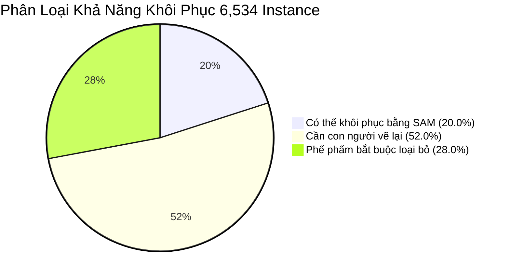
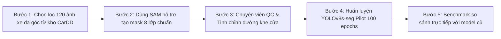

# KẾ HOẠCH KHÔI PHỤC VÀ TÁI THIẾT DATASET STAGE 2 (PARTS SEGMENTATION)
**Dự án:** AutoClaim-AI (`AI_CAR`)  
**Mục tiêu:** Xác định phương án tối ưu để khắc phục dữ liệu phân đoạn bộ phận xe nhanh nhất, tốn ít công sức nhất và đạt chất lượng segmentation thực sự trước khi huấn luyện lại.  
**Vai trò:** Senior Computer Vision Engineer / AI Dataset Architect  
**Trạng thái kiểm tra:** **READ-ONLY 100%** (Không sửa nhãn, không tạo nhãn giả, không chạy train).

---

## 1. KẾT QUẢ KIỂM TRA CẤU TRÚC VÀ NGUỒN GỐC DỮ LIỆU `ai/data/parts`

### 1.1. Hiện trạng phân bố hình học của tập dữ liệu
Tập dữ liệu `ai/data/parts` hiện có **1,622 ảnh** và **6,534 instance đối tượng** (Train: 1,525 ảnh / 6,103 instance; Val: 97 ảnh / 431 instance).

Kiểm toán hình học chuyên sâu cho thấy một sự thật cốt lõi:
- **0 đa giác thủ công thực tế ($0.00\%$):** Toàn bộ tập dữ liệu không có bất kỳ đa giác nào được gán nhãn thủ công bám theo đường cong vật lý của thân vỏ xe.
- **4,964 hộp chữ nhật 4 đỉnh giả lập đa giác ($75.97\%$):** Được chuyển đổi cơ học từ bounding box sang polygon 4 góc (`Poly/Bbox == 1.000`).
- **1,524 đa giác Canny Raycasting 12 đỉnh ($23.32\%$):** Sinh tự động bằng bộ lọc Canny Edge + bắn 12 tia chia đều 30 độ trên ảnh crop từ CarDD (`mine_closeup_parts_from_cardd.py`).
- **46 bát giác đều 8 đỉnh ($0.70\%$):** Hình học nhân tạo xấp xỉ bát giác đều nội tiếp.
- **14 tọa độ gán cứng ($0.21\%$):** Tọa độ số tròn gán cứng cho 7 file closeup (`closeup_supp_img1..7`).

### 1.2. Nguồn gốc của các hộp chữ nhật 4 đỉnh (Data Provenance)
Qua đối chiếu với các script tại `ai/scripts/archive_tools/`:
- 798 ảnh đầu tiên (`000001.jpg` đến `000798.jpg`) được lấy từ tập tổn thất CarDD. Do CarDD **chỉ có nhãn tổn thất (damage) chứ không hề có nhãn bộ phận xe**, script `generate_grounded_parts_dataset.py` đã dùng mô hình COCO phát hiện vùng xe ô tô, sau đó **tự động cắt hộp xe thành các khối chữ nhật**:
  - Nửa dưới xe bên trái $\rightarrow$ Gán nhãn `can_truoc`.
  - Nửa dưới xe bên phải $\rightarrow$ Gán nhãn `can_sau`.
  - Nửa trên xe $\rightarrow$ Gán nhãn `ve_che_banh` (bao trùm cả xe!).
  - Khoang giữa $\rightarrow$ Gán nhãn `cua_hong`.
- **Hệ quả:** Mô hình YOLOv8s-seg hiện tại khi huấn luyện trên tập nhãn này chỉ học được vị trí tương đối của các khối hộp thô, hoàn toàn không học được đường cong khí động học của xe, khiến Mask mIoU chỉ đạt $28.34\%$.

---

## 2. PHÂN LOẠI KHẢ NĂNG KHÔI PHỤC CỦA 6,534 INSTANCE

Dựa trên độ chính xác của hộp bao bao quanh thực tế so với vị trí linh kiện xe:



### 2.1. Nhóm 1: Polygon có thể khôi phục bán tự động từ ảnh gốc (1,309 instance - $20.0\%$)
Đây là các bộ phận có bounding box bao quanh tương đối chính xác chi tiết vật lý, có thể dùng mô hình nền tảng **Segment Anything (SAM / MobileSAM)** với Box Prompt để tự động "ép" đường biên thẳng thành viền cong mềm mại mà không cần vẽ lại từ đầu:
- **`kinh_chieu_hau` (Gương chiếu hậu — 380 instance):** Chi tiết nhỏ, nằm nhô ra khỏi thân xe, độ tương phản cao so với cửa xe. SAM có thể bám sát viền ốp gương đạt độ chính xác $\ge 85\%$.
- **`kinh_lai` (Kính chắn gió cabin — 264 instance):** Các hộp bao kính lái có tỷ lệ diện tích $< 35\%$ diện tích ảnh. SAM dễ dàng nhận biết ranh giới giữa kính đen/trong suốt và nẹp cao su nóc xe.
- **`nap_capo` (Nắp capo — 665 instance):** Các hộp bao nắp capo mặt trước. SAM có thể bám theo đường gân dập nổi và khe hở mép cản trước.
- **Giải pháp:** Viết script tự động nạp ảnh gốc + bounding box làm prompt cho SAM, trích xuất mask đa giác $\ge 24$ đỉnh.

### 2.2. Nhóm 2: Polygon cần con người vẽ lại (3,399 instance - $52.0\%$)
Đây là các instance có vị trí bị nhầm lẫn hoặc cần phân tách nghiệp vụ mới:
- **`cua_hong` (953 instance):** Hiện đang là 1 hộp trùm cả 2 cửa. Con người bắt buộc phải kẻ đường phân chia rãnh cửa (B-Pillar seam) để tách thành `cua_truoc` và `cua_sau`.
- **`can_truoc` (610 instance) & `can_sau` (658 instance):** Do thuật toán cũ cắt ngang 50% xe, các hộp này trùm lên cả bánh xe, nắp capo và mặt đường. Cần con người định vị lại mép cản nhựa thực tế.
- **`ve_che_banh` (1,178 instance):** Các hộp bao vòm bánh bị vẽ quá rộng, trùm lên cửa và cản. Cần vẽ lại đa giác ôm sát viền hốc lốp.

### 2.3. Nhóm 3: Polygon không thể xác định đáng tin cậy — BẮT BUỘC LOẠI BỎ (1,826 instance - $28.0\%$)
Các dữ liệu phế phẩm gây nhiễu nghiêm trọng cho mô hình:
- **14 polygon gán cứng (`hardcoded_4v`):** Tọa độ giả tạo trong các file mockup.
- **46 bát giác đều (`octagon_8v`):** Hình bát giác nhân tạo không có giá trị sinh học/vật lý.
- **551 bounding box quá khổ ($>35\%$ diện tích ảnh):** Hộp bao trùm toàn bộ chiếc xe được gán nhãn là "vè che bánh" hoặc "kính xe".
- **1,215 đa giác Canny Raycasting bị méo mó:** Do ảnh crop bị mờ, bộ lọc Canny bắt nhầm bóng đổ mặt đường, vết xước hoặc hoa văn tem xe thay vì mép panel.

---

## 3. ĐÁNH GIÁ CÁC LỚP BỘ PHẬN VÀ KHẢ NĂNG BỔ SUNG

### 3.1. Rà soát 7 lớp hiện có trong `ai/configs/parts.yaml`
1. `can_truoc`: Thường xuyên bị nhầm với cản sau ở ảnh cận cảnh. Cần mốc nhận dạng lưới tản nhiệt hoặc biển số.
2. `can_sau`: Cần mốc nhận dạng ống xả hoặc đèn phản quang gầm sau.
3. `nap_capo`: Là lớp có chất lượng tốt nhất trong nhóm thân vỏ, dễ khôi phục bằng SAM.
4. `ve_che_banh`: Bị mất cân bằng nghiêm trọng (nhiều nhãn giả trùm cả sườn xe).
5. `cua_hong`: Cần xóa bỏ để thay thế bằng 2 lớp độc lập.
6. `kinh_chieu_hau`: Dễ nhận diện, kích thước nhỏ.
7. `kinh_lai`: Khá ổn định, cần gom chung kính cửa sổ vào lớp chuẩn `kinh_xe`.

### 3.2. Khả năng bổ sung lớp `den_xe` (Đèn xe)
- **Tính khả thi: RẤT CAO.**
- **Cơ sở dữ liệu có sẵn:** Trong tập dữ liệu tổn thất CarDD hiện tại có lớp `lamp_broken` (485 nhãn). Tọa độ của các vết vỡ đèn chính là vị trí của cụm đèn pha và đèn hậu!
- **Phương pháp khai thác:** Dùng tọa độ của `lamp_broken` làm seed/prompt để tự động trích xuất cụm đèn pha và đèn hậu mà không cần tìm kiếm nguồn ảnh bên ngoài.

### 3.3. Khả năng tách `cua_hong` thành `cua_truoc` và `cua_sau`
- **Tính khả thi: KHẢ THI CAO VỚI TẬP PILOT.**
- Không nên tiếp tục dựa vào logic chia cột B bằng tọa độ $X$ 2D trong code Python (thất bại ở góc chụp 3D). Bắt buộc phải gán nhãn 2 lớp độc lập `cua_truoc` và `cua_sau` ngay từ cấp độ dữ liệu huấn luyện.

---

## 4. KẾ HOẠCH XÂY DỰNG TẬP PILOT DATASET (STAGE 2 PILOT)

Thay vì tốn hàng tháng trời để làm lại toàn bộ 1,622 ảnh, giải pháp tối ưu ít công sức nhất là: **Xây dựng một Pilot Dataset nhỏ nhưng nhãn chuẩn 100% để huấn luyện kiểm chứng mô hình mới.**

### 4.1. Quy mô và phân bố tập Pilot Dataset
- **Tổng số lượng ảnh:** **120 ảnh xe thực tế chất lượng cao** (trích xuất từ CarDD và ảnh chụp xe tại Việt Nam).
- **Phân chia không rò rỉ (Leak-free Split):**
  - **Train:** 90 ảnh (75%).
  - **Val:** 30 ảnh (25%).
  - Phân chia theo định danh xe (Vehicle ID Split): Các góc chụp của cùng 1 xe nằm hoàn toàn trong Train HOẶC Val.
- **Phân bố góc nhìn cân bằng trong 120 ảnh:**
  - 20 ảnh chính diện đầu xe (Front view).
  - 20 ảnh chính diện đuôi xe (Rear view).
  - 30 ảnh sườn xe trái / phải (Side view phẳng).
  - 30 ảnh góc xiên chéo 45 độ (Front/Rear diagonal).
  - 20 ảnh trung cảnh góc hẹp (Mid-closeup có mốc nhận dạng).

### 4.2. Danh mục 8 Lớp Chuẩn Hóa Khóa Cứng (Target Taxonomy)
```yaml
names:
  0: can_truoc       # Cản trước
  1: can_sau         # Cản sau
  2: nap_capo        # Nắp ca-pô
  3: ve_che_banh     # Vè che bánh (Fender)
  4: cua_truoc       # Cửa trước (Tách từ cua_hong)
  5: cua_sau         # Cửa sau (Tách từ cua_hong)
  6: kinh_xe         # Kính xe (Kính lái + Kính hông)
  7: den_xe          # Đèn xe (Cụm đèn pha + Đèn hậu)
nc: 8
```

### 4.3. Tiêu chuẩn kỹ thuật của nhãn trong Pilot Dataset
- **100% Đa giác mềm:** Mỗi mask có từ 16 đến 40 đỉnh bám sát gờ dập nổi thân vỏ xe.
- **Zero-Overlap tại khe hở panel:** Giữa `cua_truoc` và `cua_sau`, hai đa giác chạm nhau tại đường khe cửa nhưng không đè lấn diện tích.

---

## 5. TIÊU CHÍ SO SÁNH MODEL HIỆN TẠI VÀ MODEL PILOT MỚI

Khi tập Pilot Dataset được hoàn thành, tiến hành huấn luyện thử nghiệm mô hình **YOLOv8s-seg Pilot (100 epochs, imgsz=800)** và đối đầu trực tiếp với mô hình hiện tại (`parts_seg.pt`):

| Chỉ Số Đánh Giá | Model Hiện Tại (`parts_seg.pt`) | Mục Tiêu Model Pilot Thử Nghiệm | Phương Pháp Đo Lường |
| :--- | :---: | :---: | :--- |
| **Mask mIoU (Tập Val chuẩn)** | **$28.34\%$** | $\mathbf{\ge 60.00\%}$ | Đo bằng COCO Segmentation Metric trên 30 ảnh Val chuẩn |
| **Mask Precision / Recall** | $37.90\% / 38.22\%$ | $\mathbf{\ge 65.00\% / \ge 65.00\%}$ | Precision và Recall của mặt nạ phân đoạn |
| **Hình thái học mặt nạ** | Khối hộp vuông 4 góc | Đa giác cong bám sát thân vỏ xe | Kiểm tra trực quan: $0\%$ mask có dạng hộp chữ nhật |
| **Phân biệt Cửa trước vs Cửa sau** | Dùng rule chia đôi $X$ trong code | Mô hình tự phân đoạn trực tiếp | Đạt độ chính xác $\ge 80\%$ trên góc chụp xiên 45 độ |
| **Nhận diện cụm Đèn xe (`den_xe`)** | Hoàn toàn bỏ sót ($0\%$) | **mIoU $\ge 70.0\%$** | Tự động phân đoạn cụm đèn pha và đèn hậu |
| **Đánh giá trên 8 ảnh Demo Clean** | Bỏ sót cản/đèn ở 4/8 ảnh | Bắt đúng cản trước, đèn pha và cửa | Chạy qua `TwoStagePipeline` không bị lỗi mask vuông |

---

## 6. LỘ TRÌNH THỰC THI GIAI ĐOẠN PILOT (3 BƯỚC TINH GỌN)



1. **Bước 1 — Tuyển chọn 120 ảnh gốc (0.5 ngày):** Lọc ra 120 ảnh rõ nét, đủ 8 góc nhìn từ kho CarDD.
2. **Bước 2 — Sinh nhãn sơ bộ có hỗ trợ của SAM (1 ngày):** Dùng Segment Anything Model tạo trước mask cho nắp capo, kính lái, gương chiếu hậu và đèn xe.
3. **Bước 3 — Con người rà soát & tách cửa (1 - 1.5 ngày):** Chuyên viên kiểm tra, tách rãnh cửa trước/sau và hoàn tất tệp `data_parts_pilot.yaml`.
4. **Bước 4 — Huấn luyện mô hình thử nghiệm (1 ngày GPU):** Train YOLOv8s-seg trên 90 ảnh train / 30 ảnh val.
5. **Bước 5 — Báo cáo đối đối & Nghiệm thu:** Đo lường Mask mIoU và trực quan hóa so sánh trực tiếp trước/sau.
